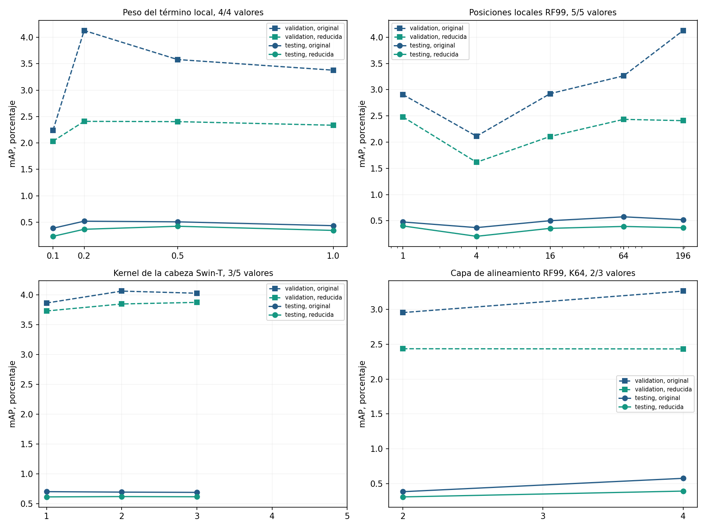
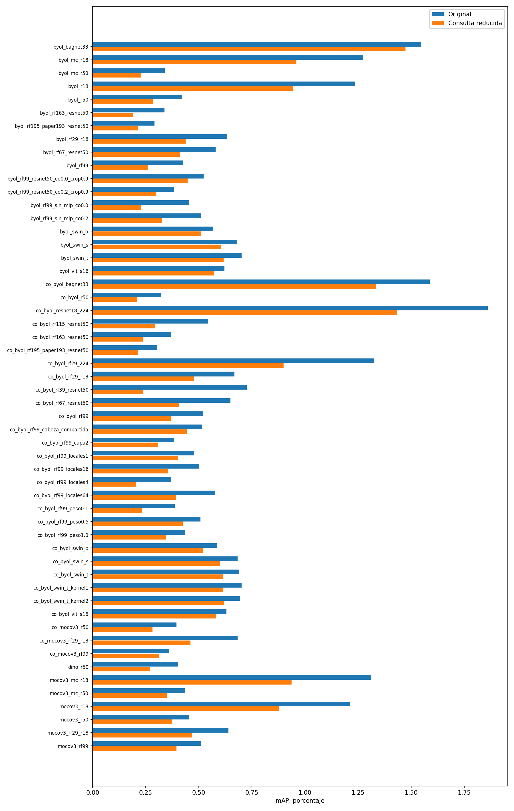
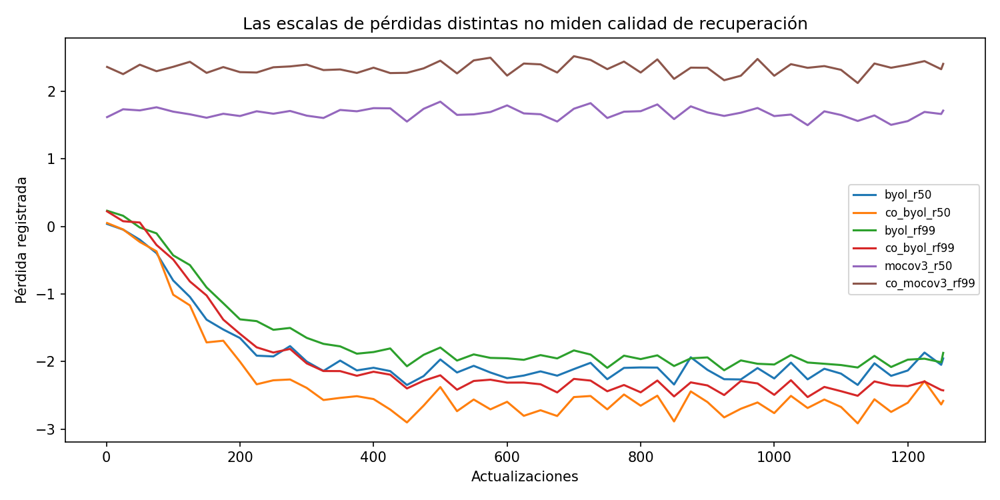
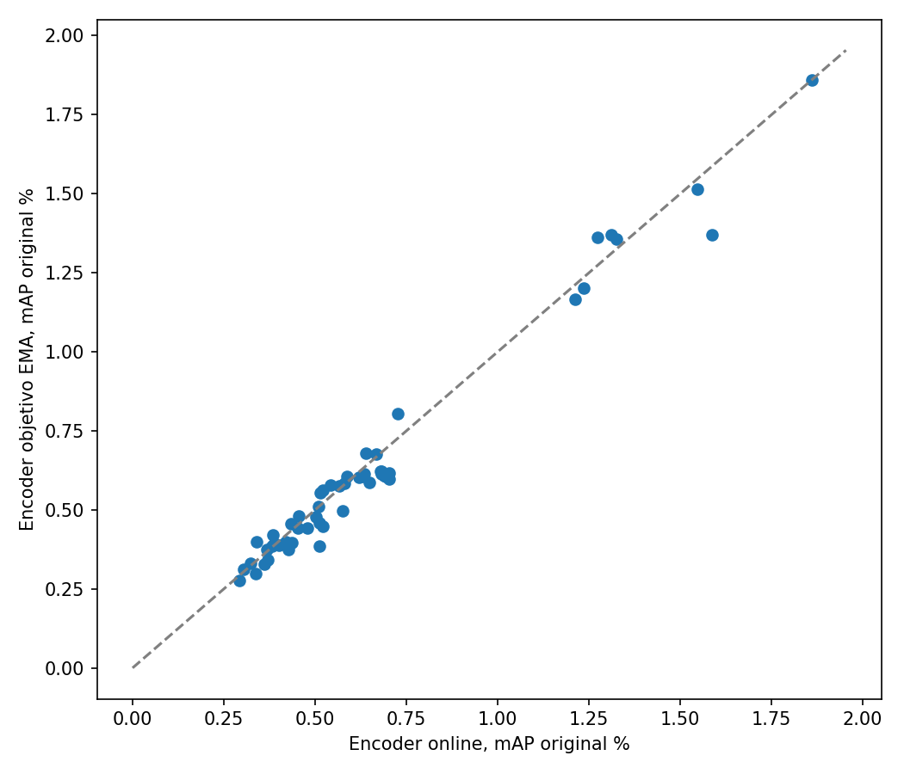
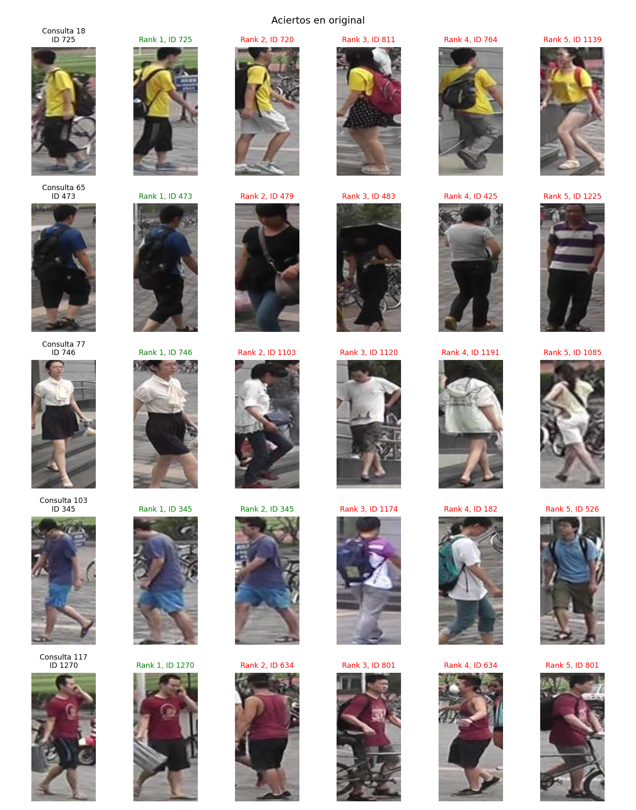
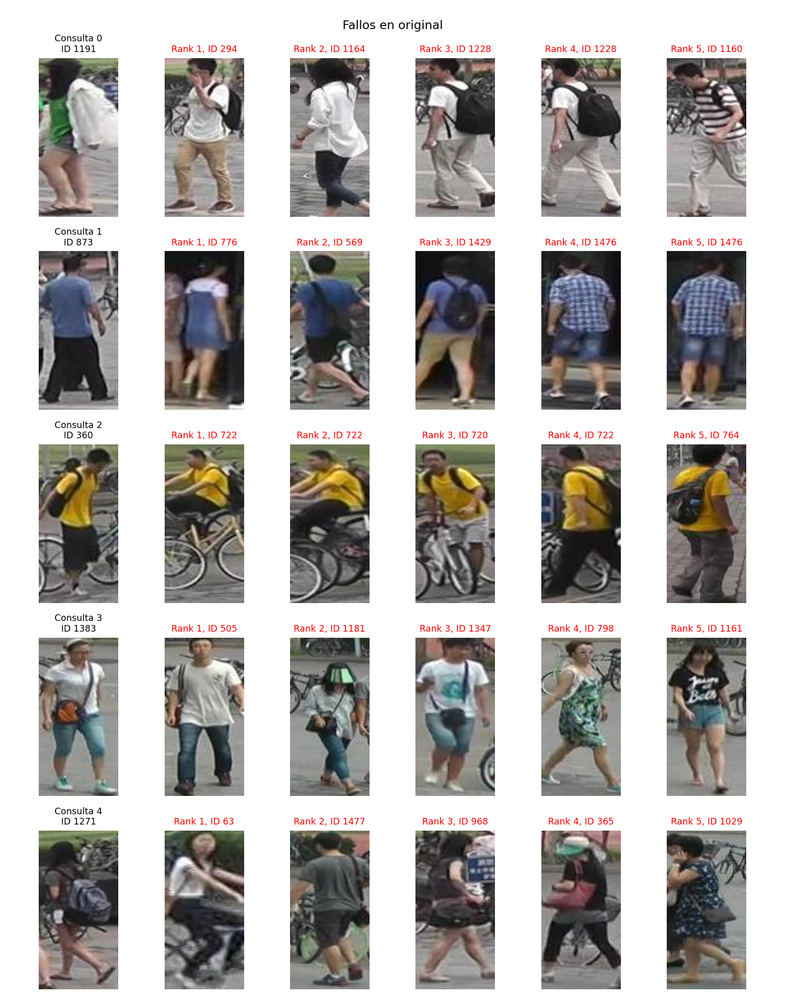
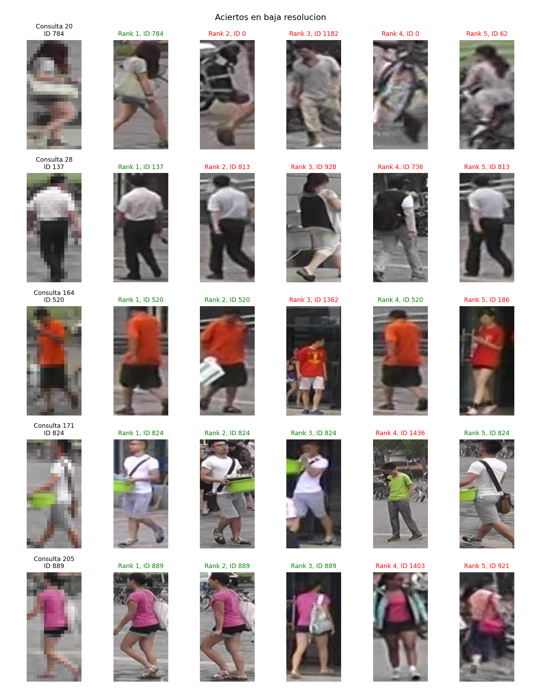
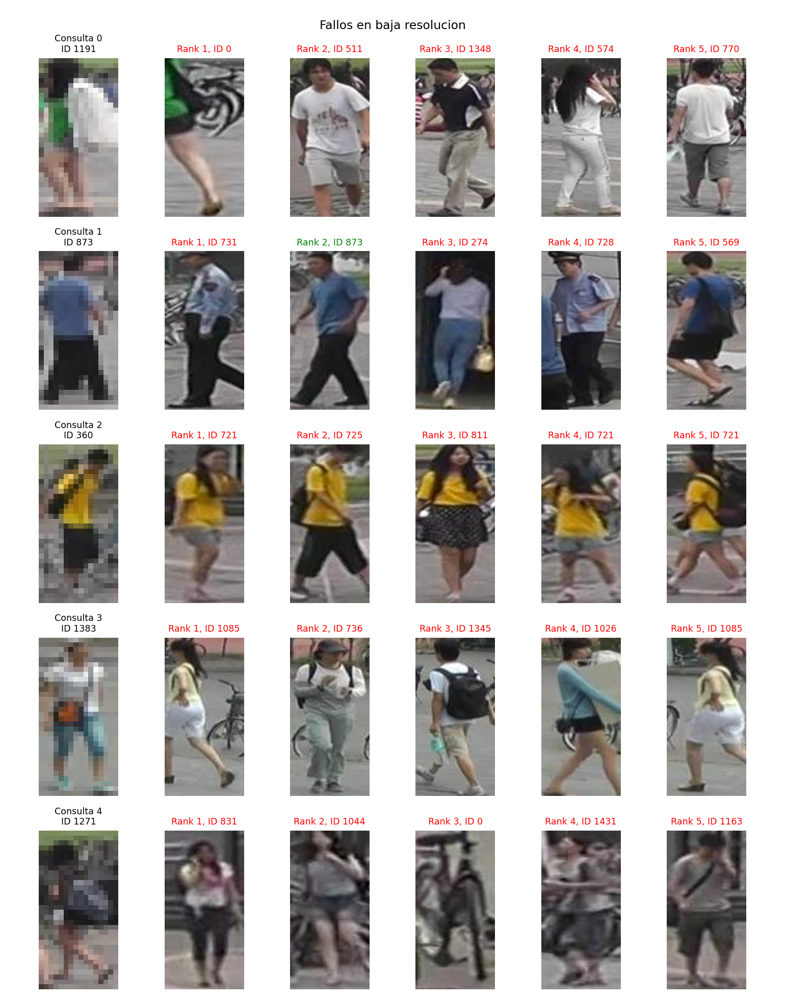
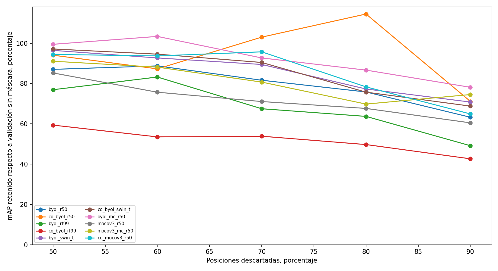
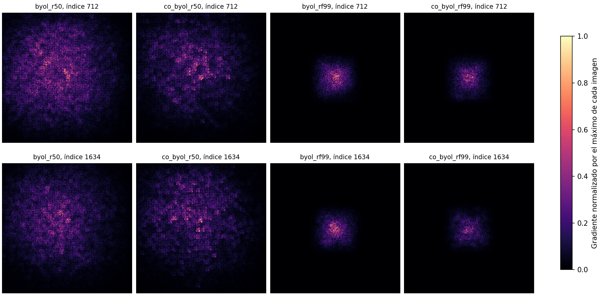

# Informe de implementación y ejecución

El proyecto implementa CO-BYOL y CO-MoCoV3 para recuperación de personas sin etiquetas de identidad durante el entrenamiento, la comparación con ImageNet del artículo se sustituye por el protocolo de recuperación exigido por el laboratorio, las conclusiones se limitan a las ejecuciones registradas en este equipo.

## Estado comprobable

La comparación ampliada cuenta con 14 arquitecturas evaluadas bajo CO-BYOL online a resolución 224, la selección de ese panel mediante validación es co_byol_resnet18_224 con mAP medio de validación 9.389 por ciento, COMPARACION_ARQUITECTURAS.md contiene la tabla común y mantiene separada la selección histórica del panel inicial.

La sesión inicial registró 171.58 minutos y la continuación autorizada registró 98.96 minutos, cada autorización tiene su presupuesto independiente y no se presenta la suma como una única sesión de tres horas.

La revisión contra las fuentes se encuentra en REVISION_CUMPLIMIENTO.md, los requisitos experimentales básicos del laboratorio tienen evidencia y el alcance completo del artículo sigue parcial, la auditoría automática de coherencia no certifica una reproducción íntegra.

Se registran 54 entrenamientos con resumen, 54 completaron el número local de actualizaciones planificadas y 54 tienen prueba completa en ambas ramas y resoluciones, el panel principal contiene 29 configuraciones y la matriz ampliada contiene 144 filas de configuración, una fila programada no constituye un experimento ejecutado.

El estado de las verificaciones técnicas es aprobado, el límite de la sesión inicial es de 3 horas y su registro conserva un inicio único para calibración, entrenamiento, validación y prueba, el tiempo transcurrido de esa sesión es 171.58 minutos.

## Resultado de la selección histórica del panel inicial

La selección previa a prueba corresponde a co_byol_bagnet33 con rama online, no se escoge esta fila por su resultado de prueba.

| Condición | mAP % | Rank 1 % | Rank 5 % | Rank 10 % |
|---|---:|---:|---:|---:|
| original | 1.587 | 4.632 | 10.125 | 13.925 |
| baja resolucion | 1.334 | 3.385 | 7.601 | 10.243 |

La caída absoluta es 0.253 puntos porcentuales y la caída relativa es 15.921 por ciento.

## Condiciones del experimento

Se conserva training con 11043 imágenes, validation con 100 consultas y 1793 imágenes de galería, testing con 3368 consultas y 19732 imágenes de galería, las consultas reducidas se leen de su dataset HDF5 original y mantienen la galería original, no se crea una división nueva ni se utiliza final_training para incorporar validación al aprendizaje.

El batch físico elegido es 8 y la planificación común es de 1253 actualizaciones, estos valores proceden de la restricción de recursos y de la calibración local, no se atribuyen al PDF ni a los HDF5, la columna de época equivalente indica cuánta exposición efectiva recibió cada modelo.

Los modelos parten de inicialización aleatoria, la lectura de entrenamiento devuelve exclusivamente imágenes y sus índices, las identidades y cámaras de validación y prueba intervienen en la medición de recuperación, los índices de cámara no se utilizan para construir objetivos de entrenamiento.

Las vistas de entrenamiento se construyen con recortes y aumentos fotométricos autosupervisados, el panel principal emplea 224 por 224 y los modelos pequeños 64 por 64, el intervalo de aspecto del recorte se adapta a personas verticales, los resultados entre paneles no aíslan el efecto de la arquitectura o de la pérdida.

Los encoders se comparan mediante vectores L2 y producto escalar coseno, se ignora person_ids igual a -1 y la coincidencia de identidad y cámara, person_ids igual a 0 permanece como distractor, AP se define como la media de la precisión en las posiciones relevantes, los empates se resuelven conservando el orden original de galería.

La documentación oficial de Market-1501 fundamenta las exclusiones de evaluación, el artículo seleccionado no define este protocolo de reidentificación, la adaptación se declara de forma separada para no atribuirle reglas ausentes, fuente https://zheng-lab-anu.github.io/Project/project_reid.html.

La caída absoluta de mAP es 100 por mAP original menos mAP reducida en puntos porcentuales, la caída relativa es 100 por esa diferencia dividida por mAP original, una caída negativa representa una mejora y no se recorta a cero.

La selección principal entre las configuraciones del panel inicial es co_byol_bagnet33 con rama online, el criterio es la media de mAP de validación en las dos resoluciones, esta selección se guarda antes de abrir la fase de prueba y la ampliación de sensibilidad no la sustituye después de conocer prueba.

## Exposición real de entrenamiento

| Modelo | Estado | Pasos | Imágenes procesadas | Imágenes distintas | Épocas equivalentes | Minutos |
|---|---|---:|---:|---:|---:|---:|
| byol_bagnet33 | entrenamiento_completado | 1253 | 10024 | 10024 | 0.9080 | 2.79 |
| byol_mc_r18 | entrenamiento_completado | 1253 | 10024 | 10024 | 0.9080 | 1.21 |
| byol_mc_r50 | entrenamiento_completado | 1253 | 10024 | 10024 | 0.9080 | 3.00 |
| byol_r18 | entrenamiento_completado | 1253 | 10024 | 10024 | 0.9080 | 0.60 |
| byol_r50 | entrenamiento_completado | 1253 | 10024 | 10024 | 0.9080 | 1.58 |
| byol_rf163_resnet50 | entrenamiento_completado | 1253 | 10024 | 10024 | 0.9080 | 1.49 |
| byol_rf195_paper193_resnet50 | entrenamiento_completado | 1253 | 10024 | 10024 | 0.9080 | 1.56 |
| byol_rf29_r18 | entrenamiento_completado | 1253 | 10024 | 10024 | 0.9080 | 1.04 |
| byol_rf67_resnet50 | entrenamiento_completado | 1253 | 10024 | 10024 | 0.9080 | 4.10 |
| byol_rf99 | entrenamiento_completado | 1253 | 10024 | 10024 | 0.9080 | 2.30 |
| byol_rf99_resnet50_co0.0_crop0.9 | entrenamiento_completado | 1253 | 10024 | 10024 | 0.9080 | 3.31 |
| byol_rf99_resnet50_co0.2_crop0.9 | entrenamiento_completado | 1253 | 10024 | 10024 | 0.9080 | 3.43 |
| byol_rf99_sin_mlp_co0.0 | entrenamiento_completado | 1253 | 10024 | 10024 | 0.9080 | 2.15 |
| byol_rf99_sin_mlp_co0.2 | entrenamiento_completado | 1253 | 10024 | 10024 | 0.9080 | 2.32 |
| byol_swin_b | entrenamiento_completado | 1253 | 10024 | 10024 | 0.9080 | 3.73 |
| byol_swin_s | entrenamiento_completado | 1253 | 10024 | 10024 | 0.9080 | 3.40 |
| byol_swin_t | entrenamiento_completado | 1253 | 10024 | 10024 | 0.9080 | 1.85 |
| byol_vit_s16 | entrenamiento_completado | 1253 | 10024 | 10024 | 0.9080 | 1.02 |
| co_byol_bagnet33 | entrenamiento_completado | 1253 | 10024 | 10024 | 0.9080 | 2.86 |
| co_byol_r50 | entrenamiento_completado | 1253 | 10024 | 10024 | 0.9080 | 1.57 |
| co_byol_resnet18_224 | entrenamiento_completado | 1253 | 10024 | 10024 | 0.9080 | 3.37 |
| co_byol_rf115_resnet50 | entrenamiento_completado | 1253 | 10024 | 10024 | 0.9080 | 2.80 |
| co_byol_rf163_resnet50 | entrenamiento_completado | 1253 | 10024 | 10024 | 0.9080 | 1.46 |
| co_byol_rf195_paper193_resnet50 | entrenamiento_completado | 1253 | 10024 | 10024 | 0.9080 | 1.49 |
| co_byol_rf29_224 | entrenamiento_completado | 1253 | 10024 | 10024 | 0.9080 | 10.93 |
| co_byol_rf29_r18 | entrenamiento_completado | 1253 | 10024 | 10024 | 0.9080 | 1.06 |
| co_byol_rf39_resnet50 | entrenamiento_completado | 1253 | 10024 | 10024 | 0.9080 | 41.48 |
| co_byol_rf67_resnet50 | entrenamiento_completado | 1253 | 10024 | 10024 | 0.9080 | 3.91 |
| co_byol_rf99 | entrenamiento_completado | 1253 | 10024 | 10024 | 0.9080 | 2.46 |
| co_byol_rf99_cabeza_compartida | entrenamiento_completado | 1253 | 10024 | 10024 | 0.9080 | 2.41 |
| co_byol_rf99_capa2 | entrenamiento_completado | 1253 | 10024 | 10024 | 0.9080 | 2.26 |
| co_byol_rf99_locales1 | entrenamiento_completado | 1253 | 10024 | 10024 | 0.9080 | 2.30 |
| co_byol_rf99_locales16 | entrenamiento_completado | 1253 | 10024 | 10024 | 0.9080 | 2.57 |
| co_byol_rf99_locales4 | entrenamiento_completado | 1253 | 10024 | 10024 | 0.9080 | 2.60 |
| co_byol_rf99_locales64 | entrenamiento_completado | 1253 | 10024 | 10024 | 0.9080 | 2.32 |
| co_byol_rf99_peso0.1 | entrenamiento_completado | 1253 | 10024 | 10024 | 0.9080 | 2.35 |
| co_byol_rf99_peso0.5 | entrenamiento_completado | 1253 | 10024 | 10024 | 0.9080 | 2.35 |
| co_byol_rf99_peso1.0 | entrenamiento_completado | 1253 | 10024 | 10024 | 0.9080 | 2.36 |
| co_byol_swin_b | entrenamiento_completado | 1253 | 10024 | 10024 | 0.9080 | 3.69 |
| co_byol_swin_s | entrenamiento_completado | 1253 | 10024 | 10024 | 0.9080 | 3.58 |
| co_byol_swin_t | entrenamiento_completado | 1253 | 10024 | 10024 | 0.9080 | 2.05 |
| co_byol_swin_t_kernel1 | entrenamiento_completado | 1253 | 10024 | 10024 | 0.9080 | 1.78 |
| co_byol_swin_t_kernel2 | entrenamiento_completado | 1253 | 10024 | 10024 | 0.9080 | 1.76 |
| co_byol_vit_s16 | entrenamiento_completado | 1253 | 10024 | 10024 | 0.9080 | 1.51 |
| co_mocov3_r50 | entrenamiento_completado | 1253 | 10024 | 10024 | 0.9080 | 1.35 |
| co_mocov3_rf29_r18 | entrenamiento_completado | 1253 | 10024 | 10024 | 0.9080 | 1.08 |
| co_mocov3_rf99 | entrenamiento_completado | 1253 | 10024 | 10024 | 0.9080 | 2.24 |
| dino_r50 | entrenamiento_completado | 1253 | 10024 | 10024 | 0.9080 | 2.75 |
| mocov3_mc_r18 | entrenamiento_completado | 1253 | 10024 | 10024 | 0.9080 | 1.16 |
| mocov3_mc_r50 | entrenamiento_completado | 1253 | 10024 | 10024 | 0.9080 | 2.40 |
| mocov3_r18 | entrenamiento_completado | 1253 | 10024 | 10024 | 0.9080 | 0.53 |
| mocov3_r50 | entrenamiento_completado | 1253 | 10024 | 10024 | 0.9080 | 1.19 |
| mocov3_rf29_r18 | entrenamiento_completado | 1253 | 10024 | 10024 | 0.9080 | 0.88 |
| mocov3_rf99 | entrenamiento_completado | 1253 | 10024 | 10024 | 0.9080 | 2.05 |

## Métricas por modelo y rama

Las tablas muestran mAP y Rank como porcentajes, metricas.csv y los JSON conservan proporciones de cero a uno sin redondear, caida_pp utiliza puntos porcentuales y caida_relativa utiliza porcentaje.

| Modelo | Rama | Partición | mAP original | R1 | R5 | R10 | mAP reducida | R1 LR | R5 LR | R10 LR | Caída pp |
|---|---|---|---:|---:|---:|---:|---:|---:|---:|---:|---:|
| byol_bagnet33 | online | validation | 9.682 | 18.000 | 39.000 | 50.000 | 7.935 | 19.000 | 26.000 | 35.000 | 1.746 |
| byol_bagnet33 | objetivo | validation | 9.233 | 19.000 | 37.000 | 47.000 | 7.352 | 20.000 | 31.000 | 41.000 | 1.880 |
| byol_bagnet33 | online | testing | 1.548 | 3.979 | 9.798 | 14.489 | 1.473 | 3.890 | 8.937 | 12.470 | 0.075 |
| byol_bagnet33 | objetivo | testing | 1.513 | 4.305 | 10.065 | 14.192 | 1.355 | 3.444 | 8.551 | 11.580 | 0.158 |
| byol_mc_r18 | online | validation | 6.534 | 16.000 | 28.000 | 38.000 | 5.495 | 10.000 | 22.000 | 30.000 | 1.039 |
| byol_mc_r18 | objetivo | validation | 7.507 | 19.000 | 30.000 | 37.000 | 5.893 | 11.000 | 19.000 | 26.000 | 1.614 |
| byol_mc_r18 | online | testing | 1.273 | 2.939 | 7.631 | 11.609 | 0.960 | 1.930 | 5.077 | 7.779 | 0.314 |
| byol_mc_r18 | objetivo | testing | 1.361 | 2.939 | 7.660 | 11.580 | 0.985 | 1.841 | 4.721 | 7.393 | 0.376 |
| byol_mc_r50 | online | validation | 2.082 | 1.000 | 11.000 | 17.000 | 2.292 | 5.000 | 13.000 | 16.000 | -0.211 |
| byol_mc_r50 | objetivo | validation | 2.897 | 6.000 | 17.000 | 20.000 | 2.381 | 5.000 | 13.000 | 16.000 | 0.516 |
| byol_mc_r50 | online | testing | 0.339 | 0.564 | 1.960 | 3.414 | 0.228 | 0.267 | 1.247 | 2.257 | 0.111 |
| byol_mc_r50 | objetivo | testing | 0.398 | 0.534 | 2.375 | 4.038 | 0.267 | 0.475 | 1.485 | 2.494 | 0.130 |
| byol_r18 | online | validation | 6.534 | 14.000 | 26.000 | 38.000 | 5.451 | 11.000 | 17.000 | 23.000 | 1.083 |
| byol_r18 | objetivo | validation | 6.804 | 11.000 | 31.000 | 41.000 | 5.444 | 9.000 | 19.000 | 22.000 | 1.359 |
| byol_r18 | online | testing | 1.235 | 2.464 | 7.482 | 11.223 | 0.943 | 1.752 | 4.662 | 7.215 | 0.292 |
| byol_r18 | objetivo | testing | 1.201 | 2.227 | 7.007 | 11.134 | 0.879 | 1.574 | 4.424 | 6.591 | 0.322 |
| byol_r50 | online | validation | 2.441 | 3.000 | 11.000 | 20.000 | 1.900 | 3.000 | 7.000 | 11.000 | 0.540 |
| byol_r50 | objetivo | validation | 2.113 | 4.000 | 13.000 | 15.000 | 1.613 | 2.000 | 6.000 | 10.000 | 0.500 |
| byol_r50 | online | testing | 0.419 | 0.713 | 2.138 | 3.533 | 0.287 | 0.327 | 1.455 | 2.732 | 0.133 |
| byol_r50 | objetivo | testing | 0.398 | 0.564 | 1.871 | 3.147 | 0.256 | 0.327 | 1.128 | 2.524 | 0.142 |
| byol_rf163_resnet50 | online | validation | 2.364 | 0.000 | 8.000 | 15.000 | 1.892 | 3.000 | 6.000 | 10.000 | 0.472 |
| byol_rf163_resnet50 | objetivo | validation | 2.190 | 5.000 | 12.000 | 18.000 | 1.660 | 3.000 | 6.000 | 14.000 | 0.530 |
| byol_rf163_resnet50 | online | testing | 0.338 | 0.386 | 1.663 | 3.355 | 0.192 | 0.267 | 0.980 | 1.425 | 0.146 |
| byol_rf163_resnet50 | objetivo | testing | 0.298 | 0.356 | 1.099 | 2.346 | 0.171 | 0.089 | 0.624 | 1.188 | 0.127 |
| byol_rf195_paper193_resnet50 | online | validation | 2.030 | 3.000 | 7.000 | 11.000 | 1.639 | 1.000 | 5.000 | 9.000 | 0.391 |
| byol_rf195_paper193_resnet50 | objetivo | validation | 1.728 | 1.000 | 5.000 | 8.000 | 1.455 | 1.000 | 6.000 | 12.000 | 0.273 |
| byol_rf195_paper193_resnet50 | online | testing | 0.292 | 0.208 | 1.099 | 2.167 | 0.213 | 0.148 | 0.683 | 1.574 | 0.079 |
| byol_rf195_paper193_resnet50 | objetivo | testing | 0.276 | 0.327 | 1.010 | 1.722 | 0.199 | 0.119 | 0.861 | 1.395 | 0.077 |
| byol_rf29_r18 | online | validation | 4.108 | 6.000 | 17.000 | 25.000 | 2.873 | 6.000 | 17.000 | 19.000 | 1.235 |
| byol_rf29_r18 | objetivo | validation | 4.565 | 8.000 | 23.000 | 28.000 | 2.552 | 5.000 | 12.000 | 13.000 | 2.014 |
| byol_rf29_r18 | online | testing | 0.634 | 1.010 | 3.504 | 5.671 | 0.438 | 0.594 | 2.167 | 3.533 | 0.196 |
| byol_rf29_r18 | objetivo | testing | 0.613 | 1.039 | 3.266 | 5.671 | 0.440 | 0.624 | 1.752 | 3.266 | 0.172 |
| byol_rf67_resnet50 | online | validation | 4.053 | 9.000 | 16.000 | 19.000 | 2.348 | 3.000 | 11.000 | 15.000 | 1.705 |
| byol_rf67_resnet50 | objetivo | validation | 3.490 | 7.000 | 14.000 | 22.000 | 2.519 | 5.000 | 10.000 | 13.000 | 0.971 |
| byol_rf67_resnet50 | online | testing | 0.580 | 1.069 | 3.771 | 5.938 | 0.411 | 0.831 | 2.197 | 3.177 | 0.169 |
| byol_rf67_resnet50 | objetivo | testing | 0.584 | 1.128 | 3.504 | 5.879 | 0.402 | 0.594 | 2.019 | 3.414 | 0.181 |
| byol_rf99 | online | validation | 2.847 | 4.000 | 17.000 | 26.000 | 1.962 | 1.000 | 6.000 | 13.000 | 0.885 |
| byol_rf99 | objetivo | validation | 2.134 | 3.000 | 8.000 | 15.000 | 1.777 | 3.000 | 7.000 | 12.000 | 0.357 |
| byol_rf99 | online | testing | 0.428 | 0.683 | 2.257 | 3.800 | 0.262 | 0.208 | 1.069 | 1.900 | 0.166 |
| byol_rf99 | objetivo | testing | 0.375 | 0.624 | 1.871 | 3.385 | 0.230 | 0.178 | 0.831 | 1.811 | 0.145 |
| byol_rf99_resnet50_co0.0_crop0.9 | online | validation | 5.056 | 8.000 | 20.000 | 30.000 | 3.467 | 5.000 | 13.000 | 20.000 | 1.588 |
| byol_rf99_resnet50_co0.0_crop0.9 | objetivo | validation | 4.900 | 6.000 | 13.000 | 21.000 | 3.194 | 2.000 | 11.000 | 18.000 | 1.707 |
| byol_rf99_resnet50_co0.0_crop0.9 | online | testing | 0.522 | 0.624 | 3.029 | 5.137 | 0.447 | 0.653 | 2.078 | 3.652 | 0.075 |
| byol_rf99_resnet50_co0.0_crop0.9 | objetivo | testing | 0.561 | 0.742 | 2.702 | 5.048 | 0.437 | 0.594 | 2.167 | 4.038 | 0.124 |
| byol_rf99_resnet50_co0.2_crop0.9 | online | validation | 2.777 | 2.000 | 9.000 | 21.000 | 2.443 | 5.000 | 9.000 | 11.000 | 0.334 |
| byol_rf99_resnet50_co0.2_crop0.9 | objetivo | validation | 3.055 | 6.000 | 14.000 | 20.000 | 2.340 | 2.000 | 8.000 | 14.000 | 0.714 |
| byol_rf99_resnet50_co0.2_crop0.9 | online | testing | 0.382 | 0.327 | 2.078 | 3.474 | 0.297 | 0.267 | 1.247 | 2.197 | 0.085 |
| byol_rf99_resnet50_co0.2_crop0.9 | objetivo | testing | 0.384 | 0.564 | 2.138 | 3.979 | 0.280 | 0.416 | 1.633 | 2.910 | 0.104 |
| byol_rf99_sin_mlp_co0.0 | online | validation | 2.989 | 6.000 | 19.000 | 25.000 | 1.672 | 2.000 | 9.000 | 10.000 | 1.317 |
| byol_rf99_sin_mlp_co0.0 | objetivo | validation | 2.951 | 4.000 | 21.000 | 22.000 | 1.959 | 2.000 | 12.000 | 16.000 | 0.992 |
| byol_rf99_sin_mlp_co0.0 | online | testing | 0.454 | 0.920 | 3.118 | 4.869 | 0.229 | 0.445 | 1.336 | 1.871 | 0.225 |
| byol_rf99_sin_mlp_co0.0 | objetivo | testing | 0.442 | 1.010 | 3.355 | 5.433 | 0.238 | 0.386 | 1.188 | 1.960 | 0.204 |
| byol_rf99_sin_mlp_co0.2 | online | validation | 3.488 | 5.000 | 18.000 | 29.000 | 2.779 | 5.000 | 10.000 | 13.000 | 0.708 |
| byol_rf99_sin_mlp_co0.2 | objetivo | validation | 3.064 | 4.000 | 16.000 | 20.000 | 2.475 | 7.000 | 11.000 | 16.000 | 0.589 |
| byol_rf99_sin_mlp_co0.2 | online | testing | 0.512 | 1.188 | 3.593 | 5.849 | 0.326 | 0.445 | 1.989 | 3.147 | 0.186 |
| byol_rf99_sin_mlp_co0.2 | objetivo | testing | 0.459 | 0.831 | 3.058 | 4.929 | 0.335 | 0.505 | 1.722 | 3.088 | 0.124 |
| byol_swin_b | online | validation | 4.018 | 7.000 | 14.000 | 23.000 | 3.544 | 6.000 | 17.000 | 25.000 | 0.473 |
| byol_swin_b | objetivo | validation | 3.566 | 4.000 | 20.000 | 27.000 | 3.431 | 6.000 | 18.000 | 26.000 | 0.135 |
| byol_swin_b | online | testing | 0.566 | 1.010 | 3.860 | 6.532 | 0.512 | 1.099 | 3.177 | 4.899 | 0.054 |
| byol_swin_b | objetivo | testing | 0.577 | 1.277 | 4.276 | 7.037 | 0.521 | 1.247 | 3.444 | 5.730 | 0.056 |
| byol_swin_s | online | validation | 3.724 | 5.000 | 17.000 | 27.000 | 3.669 | 4.000 | 18.000 | 23.000 | 0.055 |
| byol_swin_s | objetivo | validation | 3.381 | 4.000 | 15.000 | 28.000 | 3.487 | 4.000 | 19.000 | 24.000 | -0.106 |
| byol_swin_s | online | testing | 0.680 | 1.395 | 5.166 | 8.254 | 0.605 | 1.247 | 4.424 | 6.591 | 0.076 |
| byol_swin_s | objetivo | testing | 0.621 | 1.277 | 4.662 | 7.304 | 0.564 | 1.069 | 3.741 | 5.909 | 0.057 |
| byol_swin_t | online | validation | 3.852 | 3.000 | 18.000 | 32.000 | 3.691 | 6.000 | 20.000 | 28.000 | 0.161 |
| byol_swin_t | objetivo | validation | 3.442 | 2.000 | 14.000 | 25.000 | 3.319 | 5.000 | 15.000 | 23.000 | 0.123 |
| byol_swin_t | online | testing | 0.702 | 1.099 | 5.166 | 8.254 | 0.616 | 0.742 | 3.890 | 6.384 | 0.086 |
| byol_swin_t | objetivo | testing | 0.616 | 1.010 | 4.157 | 6.591 | 0.546 | 0.683 | 3.385 | 5.849 | 0.070 |
| byol_vit_s16 | online | validation | 3.817 | 5.000 | 15.000 | 26.000 | 3.416 | 4.000 | 13.000 | 22.000 | 0.401 |
| byol_vit_s16 | objetivo | validation | 3.190 | 3.000 | 13.000 | 23.000 | 3.079 | 6.000 | 12.000 | 18.000 | 0.111 |
| byol_vit_s16 | online | testing | 0.621 | 1.069 | 4.097 | 6.443 | 0.572 | 0.713 | 3.266 | 5.790 | 0.049 |
| byol_vit_s16 | objetivo | testing | 0.602 | 1.069 | 4.394 | 6.621 | 0.535 | 0.713 | 3.177 | 5.730 | 0.067 |
| co_byol_bagnet33 | online | validation | 8.349 | 21.000 | 35.000 | 42.000 | 6.717 | 17.000 | 26.000 | 34.000 | 1.632 |
| co_byol_bagnet33 | objetivo | validation | 6.991 | 20.000 | 30.000 | 37.000 | 6.461 | 15.000 | 24.000 | 31.000 | 0.530 |
| co_byol_bagnet33 | online | testing | 1.587 | 4.632 | 10.125 | 13.925 | 1.334 | 3.385 | 7.601 | 10.243 | 0.253 |
| co_byol_bagnet33 | objetivo | testing | 1.369 | 4.038 | 9.234 | 12.975 | 1.179 | 3.058 | 6.710 | 9.709 | 0.190 |
| co_byol_r50 | online | validation | 1.863 | 4.000 | 12.000 | 18.000 | 1.372 | 1.000 | 5.000 | 7.000 | 0.491 |
| co_byol_r50 | objetivo | validation | 1.869 | 4.000 | 7.000 | 14.000 | 1.537 | 2.000 | 6.000 | 11.000 | 0.331 |
| co_byol_r50 | online | testing | 0.324 | 0.445 | 2.227 | 3.593 | 0.209 | 0.267 | 1.306 | 1.989 | 0.115 |
| co_byol_r50 | objetivo | testing | 0.331 | 0.445 | 2.257 | 3.563 | 0.241 | 0.416 | 1.366 | 2.553 | 0.090 |
| co_byol_resnet18_224 | online | validation | 10.658 | 23.000 | 34.000 | 44.000 | 8.120 | 15.000 | 24.000 | 32.000 | 2.537 |
| co_byol_resnet18_224 | objetivo | validation | 10.582 | 22.000 | 34.000 | 46.000 | 7.794 | 14.000 | 28.000 | 31.000 | 2.787 |
| co_byol_resnet18_224 | online | testing | 1.861 | 4.394 | 9.531 | 13.302 | 1.432 | 2.672 | 7.037 | 10.570 | 0.429 |
| co_byol_resnet18_224 | objetivo | testing | 1.860 | 4.543 | 9.798 | 13.688 | 1.349 | 2.405 | 6.562 | 10.095 | 0.511 |
| co_byol_rf115_resnet50 | online | validation | 3.224 | 5.000 | 14.000 | 21.000 | 1.942 | 3.000 | 8.000 | 12.000 | 1.282 |
| co_byol_rf115_resnet50 | objetivo | validation | 2.786 | 5.000 | 14.000 | 19.000 | 2.004 | 5.000 | 8.000 | 10.000 | 0.782 |
| co_byol_rf115_resnet50 | online | testing | 0.542 | 0.861 | 3.474 | 5.790 | 0.294 | 0.505 | 1.752 | 3.088 | 0.248 |
| co_byol_rf115_resnet50 | objetivo | testing | 0.578 | 1.247 | 3.593 | 5.493 | 0.318 | 0.505 | 2.019 | 3.444 | 0.259 |
| co_byol_rf163_resnet50 | online | validation | 2.482 | 4.000 | 10.000 | 22.000 | 1.989 | 3.000 | 7.000 | 10.000 | 0.493 |
| co_byol_rf163_resnet50 | objetivo | validation | 2.261 | 1.000 | 12.000 | 18.000 | 2.201 | 6.000 | 9.000 | 14.000 | 0.061 |
| co_byol_rf163_resnet50 | online | testing | 0.369 | 0.505 | 2.346 | 3.711 | 0.238 | 0.208 | 0.950 | 1.871 | 0.131 |
| co_byol_rf163_resnet50 | objetivo | testing | 0.374 | 0.772 | 1.930 | 2.999 | 0.207 | 0.208 | 1.099 | 1.752 | 0.166 |
| co_byol_rf195_paper193_resnet50 | online | validation | 2.177 | 1.000 | 8.000 | 16.000 | 1.592 | 1.000 | 6.000 | 8.000 | 0.585 |
| co_byol_rf195_paper193_resnet50 | objetivo | validation | 2.245 | 2.000 | 13.000 | 17.000 | 1.411 | 0.000 | 3.000 | 11.000 | 0.834 |
| co_byol_rf195_paper193_resnet50 | online | testing | 0.305 | 0.356 | 1.336 | 2.257 | 0.212 | 0.148 | 0.772 | 1.306 | 0.093 |
| co_byol_rf195_paper193_resnet50 | objetivo | testing | 0.313 | 0.475 | 1.277 | 2.435 | 0.164 | 0.148 | 0.505 | 0.891 | 0.149 |
| co_byol_rf29_224 | online | validation | 6.974 | 10.000 | 24.000 | 30.000 | 4.961 | 7.000 | 18.000 | 21.000 | 2.013 |
| co_byol_rf29_224 | objetivo | validation | 7.583 | 16.000 | 25.000 | 28.000 | 4.946 | 10.000 | 17.000 | 22.000 | 2.636 |
| co_byol_rf29_224 | online | testing | 1.326 | 3.236 | 7.482 | 11.075 | 0.899 | 1.752 | 4.929 | 6.829 | 0.427 |
| co_byol_rf29_224 | objetivo | testing | 1.357 | 3.029 | 7.542 | 10.600 | 0.912 | 1.692 | 4.810 | 7.126 | 0.445 |
| co_byol_rf29_r18 | online | validation | 4.553 | 8.000 | 16.000 | 25.000 | 3.008 | 3.000 | 13.000 | 20.000 | 1.545 |
| co_byol_rf29_r18 | objetivo | validation | 4.416 | 9.000 | 23.000 | 30.000 | 3.111 | 6.000 | 13.000 | 17.000 | 1.306 |
| co_byol_rf29_r18 | online | testing | 0.668 | 1.455 | 4.127 | 6.859 | 0.478 | 0.653 | 2.702 | 3.800 | 0.191 |
| co_byol_rf29_r18 | objetivo | testing | 0.677 | 1.336 | 4.038 | 6.740 | 0.470 | 0.624 | 2.346 | 3.919 | 0.207 |
| co_byol_rf39_resnet50 | online | validation | 4.011 | 8.000 | 21.000 | 29.000 | 2.102 | 2.000 | 9.000 | 9.000 | 1.909 |
| co_byol_rf39_resnet50 | objetivo | validation | 5.080 | 14.000 | 23.000 | 30.000 | 1.905 | 3.000 | 7.000 | 9.000 | 3.176 |
| co_byol_rf39_resnet50 | online | testing | 0.725 | 2.108 | 5.285 | 8.224 | 0.237 | 0.238 | 1.158 | 2.227 | 0.488 |
| co_byol_rf39_resnet50 | objetivo | testing | 0.805 | 2.435 | 6.146 | 8.581 | 0.252 | 0.445 | 1.247 | 1.900 | 0.553 |
| co_byol_rf67_resnet50 | online | validation | 3.059 | 2.000 | 14.000 | 19.000 | 2.497 | 2.000 | 10.000 | 16.000 | 0.562 |
| co_byol_rf67_resnet50 | objetivo | validation | 3.866 | 4.000 | 17.000 | 25.000 | 1.891 | 2.000 | 9.000 | 12.000 | 1.975 |
| co_byol_rf67_resnet50 | online | testing | 0.649 | 1.485 | 3.504 | 5.938 | 0.408 | 0.534 | 1.841 | 3.118 | 0.240 |
| co_byol_rf67_resnet50 | objetivo | testing | 0.586 | 1.306 | 3.741 | 5.315 | 0.386 | 0.534 | 1.989 | 3.236 | 0.201 |
| co_byol_rf99 | online | validation | 4.127 | 6.000 | 14.000 | 21.000 | 2.409 | 5.000 | 9.000 | 14.000 | 1.718 |
| co_byol_rf99 | objetivo | validation | 3.231 | 6.000 | 15.000 | 27.000 | 2.937 | 6.000 | 11.000 | 18.000 | 0.294 |
| co_byol_rf99 | online | testing | 0.521 | 0.713 | 2.643 | 4.394 | 0.367 | 0.356 | 1.663 | 2.643 | 0.153 |
| co_byol_rf99 | objetivo | testing | 0.448 | 0.683 | 2.613 | 4.365 | 0.339 | 0.653 | 1.425 | 2.405 | 0.109 |
| co_byol_rf99_cabeza_compartida | online | validation | 3.160 | 3.000 | 10.000 | 20.000 | 3.297 | 5.000 | 12.000 | 13.000 | -0.136 |
| co_byol_rf99_cabeza_compartida | objetivo | validation | 3.612 | 8.000 | 16.000 | 24.000 | 3.409 | 5.000 | 9.000 | 17.000 | 0.203 |
| co_byol_rf99_cabeza_compartida | online | testing | 0.515 | 0.742 | 2.643 | 4.335 | 0.443 | 0.772 | 2.286 | 3.682 | 0.072 |
| co_byol_rf99_cabeza_compartida | objetivo | testing | 0.553 | 0.861 | 2.702 | 5.226 | 0.468 | 0.683 | 2.078 | 3.414 | 0.085 |
| co_byol_rf99_capa2 | online | validation | 2.956 | 4.000 | 15.000 | 25.000 | 2.436 | 5.000 | 10.000 | 19.000 | 0.519 |
| co_byol_rf99_capa2 | objetivo | validation | 3.321 | 8.000 | 17.000 | 26.000 | 2.764 | 2.000 | 12.000 | 19.000 | 0.558 |
| co_byol_rf99_capa2 | online | testing | 0.384 | 0.505 | 2.257 | 3.860 | 0.309 | 0.386 | 1.395 | 3.088 | 0.075 |
| co_byol_rf99_capa2 | objetivo | testing | 0.422 | 0.356 | 2.643 | 4.186 | 0.329 | 0.356 | 1.603 | 2.791 | 0.092 |
| co_byol_rf99_locales1 | online | validation | 2.907 | 5.000 | 14.000 | 22.000 | 2.481 | 5.000 | 9.000 | 15.000 | 0.426 |
| co_byol_rf99_locales1 | objetivo | validation | 2.663 | 7.000 | 10.000 | 17.000 | 2.396 | 4.000 | 10.000 | 14.000 | 0.267 |
| co_byol_rf99_locales1 | online | testing | 0.478 | 0.683 | 2.732 | 4.513 | 0.402 | 0.683 | 1.663 | 2.643 | 0.076 |
| co_byol_rf99_locales1 | objetivo | testing | 0.443 | 0.742 | 2.494 | 4.038 | 0.372 | 0.653 | 2.108 | 3.177 | 0.071 |
| co_byol_rf99_locales16 | online | validation | 2.923 | 4.000 | 13.000 | 18.000 | 2.108 | 4.000 | 9.000 | 13.000 | 0.816 |
| co_byol_rf99_locales16 | objetivo | validation | 3.049 | 4.000 | 11.000 | 20.000 | 2.167 | 2.000 | 8.000 | 11.000 | 0.882 |
| co_byol_rf99_locales16 | online | testing | 0.502 | 0.624 | 2.643 | 4.305 | 0.356 | 0.386 | 1.574 | 2.553 | 0.146 |
| co_byol_rf99_locales16 | objetivo | testing | 0.478 | 0.653 | 2.405 | 3.979 | 0.387 | 0.475 | 1.752 | 2.910 | 0.091 |
| co_byol_rf99_locales4 | online | validation | 2.112 | 1.000 | 9.000 | 13.000 | 1.616 | 2.000 | 6.000 | 6.000 | 0.496 |
| co_byol_rf99_locales4 | objetivo | validation | 2.070 | 0.000 | 6.000 | 13.000 | 1.826 | 2.000 | 6.000 | 9.000 | 0.244 |
| co_byol_rf99_locales4 | online | testing | 0.370 | 0.683 | 1.930 | 3.355 | 0.204 | 0.297 | 0.891 | 1.217 | 0.166 |
| co_byol_rf99_locales4 | objetivo | testing | 0.343 | 0.534 | 1.663 | 3.088 | 0.215 | 0.386 | 0.861 | 1.544 | 0.128 |
| co_byol_rf99_locales64 | online | validation | 3.264 | 7.000 | 16.000 | 25.000 | 2.434 | 6.000 | 10.000 | 16.000 | 0.830 |
| co_byol_rf99_locales64 | objetivo | validation | 3.194 | 6.000 | 12.000 | 19.000 | 2.194 | 4.000 | 10.000 | 14.000 | 1.000 |
| co_byol_rf99_locales64 | online | testing | 0.576 | 1.306 | 2.850 | 4.365 | 0.393 | 0.683 | 2.019 | 3.088 | 0.183 |
| co_byol_rf99_locales64 | objetivo | testing | 0.496 | 0.653 | 2.049 | 4.127 | 0.387 | 0.564 | 1.663 | 2.969 | 0.109 |
| co_byol_rf99_peso0.1 | online | validation | 2.240 | 1.000 | 10.000 | 19.000 | 2.035 | 3.000 | 7.000 | 11.000 | 0.205 |
| co_byol_rf99_peso0.1 | objetivo | validation | 2.712 | 1.000 | 15.000 | 22.000 | 2.626 | 6.000 | 11.000 | 13.000 | 0.086 |
| co_byol_rf99_peso0.1 | online | testing | 0.387 | 0.564 | 2.227 | 3.919 | 0.234 | 0.297 | 1.099 | 1.930 | 0.153 |
| co_byol_rf99_peso0.1 | objetivo | testing | 0.392 | 0.594 | 2.316 | 4.068 | 0.291 | 0.505 | 1.306 | 2.286 | 0.101 |
| co_byol_rf99_peso0.5 | online | validation | 3.578 | 9.000 | 17.000 | 21.000 | 2.404 | 4.000 | 9.000 | 11.000 | 1.174 |
| co_byol_rf99_peso0.5 | objetivo | validation | 3.065 | 8.000 | 16.000 | 21.000 | 2.931 | 6.000 | 9.000 | 15.000 | 0.134 |
| co_byol_rf99_peso0.5 | online | testing | 0.508 | 0.861 | 2.732 | 4.483 | 0.425 | 0.713 | 2.197 | 3.414 | 0.084 |
| co_byol_rf99_peso0.5 | objetivo | testing | 0.512 | 0.891 | 3.207 | 4.929 | 0.383 | 0.505 | 1.960 | 3.771 | 0.128 |
| co_byol_rf99_peso1.0 | online | validation | 3.377 | 3.000 | 17.000 | 25.000 | 2.336 | 4.000 | 9.000 | 14.000 | 1.041 |
| co_byol_rf99_peso1.0 | objetivo | validation | 2.627 | 5.000 | 12.000 | 18.000 | 1.983 | 2.000 | 12.000 | 15.000 | 0.644 |
| co_byol_rf99_peso1.0 | online | testing | 0.436 | 0.683 | 2.405 | 3.919 | 0.346 | 0.534 | 1.633 | 2.732 | 0.090 |
| co_byol_rf99_peso1.0 | objetivo | testing | 0.398 | 0.742 | 2.049 | 3.800 | 0.300 | 0.445 | 1.455 | 2.494 | 0.097 |
| co_byol_swin_b | online | validation | 3.613 | 4.000 | 18.000 | 26.000 | 3.507 | 6.000 | 21.000 | 25.000 | 0.106 |
| co_byol_swin_b | objetivo | validation | 3.479 | 6.000 | 18.000 | 28.000 | 3.412 | 5.000 | 17.000 | 23.000 | 0.067 |
| co_byol_swin_b | online | testing | 0.587 | 1.099 | 3.919 | 6.770 | 0.522 | 0.891 | 3.444 | 5.701 | 0.066 |
| co_byol_swin_b | objetivo | testing | 0.606 | 1.425 | 4.543 | 7.185 | 0.541 | 1.247 | 3.771 | 6.087 | 0.064 |
| co_byol_swin_s | online | validation | 3.756 | 4.000 | 18.000 | 30.000 | 3.797 | 7.000 | 19.000 | 26.000 | -0.042 |
| co_byol_swin_s | objetivo | validation | 3.650 | 7.000 | 17.000 | 30.000 | 3.619 | 5.000 | 15.000 | 26.000 | 0.031 |
| co_byol_swin_s | online | testing | 0.682 | 1.544 | 5.255 | 8.017 | 0.599 | 1.099 | 4.038 | 6.799 | 0.083 |
| co_byol_swin_s | objetivo | testing | 0.622 | 1.366 | 4.869 | 7.215 | 0.532 | 0.772 | 3.504 | 6.324 | 0.090 |
| co_byol_swin_t | online | validation | 4.028 | 7.000 | 19.000 | 32.000 | 3.875 | 9.000 | 20.000 | 29.000 | 0.153 |
| co_byol_swin_t | objetivo | validation | 3.469 | 2.000 | 16.000 | 25.000 | 3.341 | 4.000 | 16.000 | 22.000 | 0.128 |
| co_byol_swin_t | online | testing | 0.689 | 1.158 | 4.899 | 7.928 | 0.616 | 0.891 | 3.800 | 6.502 | 0.073 |
| co_byol_swin_t | objetivo | testing | 0.608 | 0.920 | 3.890 | 6.977 | 0.549 | 0.772 | 3.266 | 5.938 | 0.059 |
| co_byol_swin_t_kernel1 | online | validation | 3.864 | 5.000 | 20.000 | 34.000 | 3.730 | 8.000 | 19.000 | 28.000 | 0.134 |
| co_byol_swin_t_kernel1 | objetivo | validation | 3.366 | 2.000 | 16.000 | 24.000 | 3.236 | 3.000 | 16.000 | 23.000 | 0.129 |
| co_byol_swin_t_kernel1 | online | testing | 0.702 | 1.277 | 5.018 | 8.017 | 0.614 | 0.920 | 4.216 | 6.681 | 0.088 |
| co_byol_swin_t_kernel1 | objetivo | testing | 0.598 | 0.831 | 4.216 | 7.156 | 0.544 | 0.891 | 3.355 | 5.938 | 0.055 |
| co_byol_swin_t_kernel2 | online | validation | 4.064 | 7.000 | 23.000 | 33.000 | 3.848 | 9.000 | 20.000 | 30.000 | 0.216 |
| co_byol_swin_t_kernel2 | objetivo | validation | 3.396 | 2.000 | 14.000 | 22.000 | 3.291 | 5.000 | 14.000 | 22.000 | 0.106 |
| co_byol_swin_t_kernel2 | online | testing | 0.694 | 1.099 | 4.810 | 7.987 | 0.619 | 0.802 | 4.068 | 6.859 | 0.075 |
| co_byol_swin_t_kernel2 | objetivo | testing | 0.606 | 0.950 | 4.216 | 7.126 | 0.559 | 0.891 | 3.296 | 6.087 | 0.047 |
| co_byol_vit_s16 | online | validation | 3.823 | 5.000 | 19.000 | 27.000 | 3.408 | 2.000 | 13.000 | 24.000 | 0.415 |
| co_byol_vit_s16 | objetivo | validation | 3.332 | 4.000 | 15.000 | 25.000 | 3.120 | 6.000 | 14.000 | 18.000 | 0.212 |
| co_byol_vit_s16 | online | testing | 0.630 | 1.069 | 4.186 | 6.740 | 0.581 | 0.861 | 3.207 | 5.760 | 0.049 |
| co_byol_vit_s16 | objetivo | testing | 0.607 | 1.128 | 4.305 | 6.681 | 0.535 | 0.742 | 2.910 | 5.433 | 0.071 |
| co_mocov3_r50 | online | validation | 2.401 | 4.000 | 9.000 | 17.000 | 1.706 | 2.000 | 9.000 | 17.000 | 0.695 |
| co_mocov3_r50 | objetivo | validation | 2.332 | 2.000 | 10.000 | 21.000 | 1.977 | 6.000 | 8.000 | 12.000 | 0.355 |
| co_mocov3_r50 | online | testing | 0.394 | 0.445 | 2.019 | 3.652 | 0.281 | 0.416 | 1.752 | 2.821 | 0.113 |
| co_mocov3_r50 | objetivo | testing | 0.391 | 0.713 | 2.167 | 3.593 | 0.261 | 0.356 | 1.247 | 2.227 | 0.130 |
| co_mocov3_rf29_r18 | online | validation | 4.571 | 7.000 | 18.000 | 30.000 | 3.404 | 6.000 | 12.000 | 18.000 | 1.166 |
| co_mocov3_rf29_r18 | objetivo | validation | 4.859 | 7.000 | 19.000 | 26.000 | 3.279 | 4.000 | 11.000 | 17.000 | 1.580 |
| co_mocov3_rf29_r18 | online | testing | 0.682 | 1.217 | 4.365 | 6.799 | 0.461 | 0.802 | 2.346 | 4.186 | 0.221 |
| co_mocov3_rf29_r18 | objetivo | testing | 0.615 | 1.069 | 3.741 | 6.443 | 0.427 | 0.475 | 2.019 | 3.682 | 0.188 |
| co_mocov3_rf99 | online | validation | 2.554 | 2.000 | 8.000 | 17.000 | 2.344 | 2.000 | 10.000 | 14.000 | 0.210 |
| co_mocov3_rf99 | objetivo | validation | 2.664 | 5.000 | 10.000 | 13.000 | 2.115 | 3.000 | 9.000 | 12.000 | 0.549 |
| co_mocov3_rf99 | online | testing | 0.362 | 0.534 | 2.227 | 3.563 | 0.312 | 0.475 | 1.455 | 2.761 | 0.049 |
| co_mocov3_rf99 | objetivo | testing | 0.328 | 0.416 | 1.455 | 2.850 | 0.272 | 0.386 | 1.425 | 2.375 | 0.056 |
| dino_r50 | online | validation | 2.573 | 6.000 | 13.000 | 20.000 | 2.188 | 4.000 | 7.000 | 13.000 | 0.385 |
| dino_r50 | objetivo | validation | 2.336 | 5.000 | 12.000 | 14.000 | 1.890 | 3.000 | 11.000 | 14.000 | 0.446 |
| dino_r50 | online | testing | 0.402 | 0.624 | 2.167 | 3.652 | 0.268 | 0.475 | 1.871 | 2.880 | 0.133 |
| dino_r50 | objetivo | testing | 0.388 | 0.624 | 2.227 | 4.186 | 0.238 | 0.267 | 1.069 | 2.375 | 0.150 |
| mocov3_mc_r18 | online | validation | 6.850 | 13.000 | 31.000 | 44.000 | 5.287 | 8.000 | 25.000 | 30.000 | 1.563 |
| mocov3_mc_r18 | objetivo | validation | 7.761 | 15.000 | 32.000 | 42.000 | 5.755 | 7.000 | 21.000 | 26.000 | 2.006 |
| mocov3_mc_r18 | online | testing | 1.312 | 2.850 | 7.809 | 12.233 | 0.936 | 1.841 | 5.196 | 7.809 | 0.375 |
| mocov3_mc_r18 | objetivo | testing | 1.371 | 2.910 | 8.195 | 12.144 | 0.962 | 1.871 | 5.285 | 7.720 | 0.409 |
| mocov3_mc_r50 | online | validation | 2.852 | 5.000 | 16.000 | 24.000 | 2.575 | 3.000 | 12.000 | 16.000 | 0.276 |
| mocov3_mc_r50 | objetivo | validation | 3.092 | 7.000 | 14.000 | 22.000 | 3.294 | 10.000 | 12.000 | 15.000 | -0.201 |
| mocov3_mc_r50 | online | testing | 0.435 | 0.713 | 2.702 | 4.572 | 0.349 | 0.356 | 1.900 | 3.355 | 0.086 |
| mocov3_mc_r50 | objetivo | testing | 0.457 | 0.920 | 2.999 | 5.285 | 0.333 | 0.713 | 2.316 | 3.414 | 0.124 |
| mocov3_r18 | online | validation | 7.239 | 17.000 | 31.000 | 40.000 | 5.648 | 11.000 | 18.000 | 22.000 | 1.591 |
| mocov3_r18 | objetivo | validation | 6.918 | 13.000 | 26.000 | 37.000 | 5.627 | 10.000 | 16.000 | 22.000 | 1.291 |
| mocov3_r18 | online | testing | 1.211 | 2.346 | 7.067 | 11.431 | 0.877 | 1.336 | 4.305 | 6.651 | 0.335 |
| mocov3_r18 | objetivo | testing | 1.166 | 2.019 | 7.156 | 11.134 | 0.853 | 1.544 | 4.008 | 6.473 | 0.314 |
| mocov3_r50 | online | validation | 2.674 | 4.000 | 13.000 | 21.000 | 2.401 | 3.000 | 11.000 | 14.000 | 0.273 |
| mocov3_r50 | objetivo | validation | 2.639 | 5.000 | 12.000 | 20.000 | 2.287 | 5.000 | 11.000 | 15.000 | 0.352 |
| mocov3_r50 | online | testing | 0.454 | 0.564 | 2.108 | 4.097 | 0.374 | 0.713 | 2.197 | 3.563 | 0.081 |
| mocov3_r50 | objetivo | testing | 0.482 | 0.831 | 2.524 | 4.038 | 0.331 | 0.564 | 1.722 | 3.088 | 0.151 |
| mocov3_rf29_r18 | online | validation | 4.805 | 8.000 | 25.000 | 36.000 | 2.664 | 5.000 | 13.000 | 17.000 | 2.141 |
| mocov3_rf29_r18 | objetivo | validation | 4.638 | 8.000 | 15.000 | 30.000 | 2.812 | 4.000 | 11.000 | 16.000 | 1.825 |
| mocov3_rf29_r18 | online | testing | 0.640 | 1.395 | 4.038 | 6.710 | 0.467 | 0.683 | 2.435 | 4.157 | 0.173 |
| mocov3_rf29_r18 | objetivo | testing | 0.680 | 1.069 | 3.266 | 5.968 | 0.479 | 0.831 | 2.346 | 3.860 | 0.201 |
| mocov3_rf99 | online | validation | 2.940 | 5.000 | 14.000 | 23.000 | 2.900 | 3.000 | 13.000 | 15.000 | 0.040 |
| mocov3_rf99 | objetivo | validation | 2.358 | 4.000 | 9.000 | 16.000 | 2.089 | 3.000 | 7.000 | 13.000 | 0.268 |
| mocov3_rf99 | online | testing | 0.512 | 0.772 | 2.761 | 4.543 | 0.395 | 0.475 | 1.781 | 3.147 | 0.116 |
| mocov3_rf99 | objetivo | testing | 0.386 | 0.416 | 1.930 | 3.474 | 0.291 | 0.356 | 1.514 | 2.108 | 0.096 |

## Modelo base y ablación

BYOL ResNet50 y MoCoV3 ResNet50 proporcionan modelos base, la comparación de BYOL RF99 frente a CO-BYOL RF99 conserva la arquitectura y elimina únicamente el término local mediante peso cero, la comparación entre ResNet50 estándar y RF99 cambia también la arquitectura y no se presenta como ablación aislada.

| Comparación | Rama | Partición | Diferencia mAP original pp | Diferencia mAP reducida pp |
|---|---|---|---:|---:|
| co_byol_r50 frente a byol_r50 | online | validation | -0.577 | -0.528 |
| co_byol_r50 frente a byol_r50 | online | testing | -0.095 | -0.077 |
| co_byol_r50 frente a byol_r50 | objetivo | validation | -0.244 | -0.076 |
| co_byol_r50 frente a byol_r50 | objetivo | testing | -0.067 | -0.015 |
| co_byol_rf99 frente a byol_rf99 | online | validation | 1.281 | 0.447 |
| co_byol_rf99 frente a byol_rf99 | online | testing | 0.093 | 0.106 |
| co_byol_rf99 frente a byol_rf99 | objetivo | validation | 1.096 | 1.159 |
| co_byol_rf99 frente a byol_rf99 | objetivo | testing | 0.074 | 0.109 |
| co_mocov3_r50 frente a mocov3_r50 | online | validation | -0.273 | -0.695 |
| co_mocov3_r50 frente a mocov3_r50 | online | testing | -0.060 | -0.092 |
| co_mocov3_r50 frente a mocov3_r50 | objetivo | validation | -0.307 | -0.310 |
| co_mocov3_r50 frente a mocov3_r50 | objetivo | testing | -0.091 | -0.070 |
| co_mocov3_rf99 frente a mocov3_rf99 | online | validation | -0.386 | -0.556 |
| co_mocov3_rf99 frente a mocov3_rf99 | online | testing | -0.150 | -0.083 |
| co_mocov3_rf99 frente a mocov3_rf99 | objetivo | validation | 0.306 | 0.025 |
| co_mocov3_rf99 frente a mocov3_rf99 | objetivo | testing | -0.059 | -0.019 |
| co_byol_bagnet33 frente a byol_bagnet33 | online | validation | -1.333 | -1.218 |
| co_byol_bagnet33 frente a byol_bagnet33 | online | testing | 0.040 | -0.138 |
| co_byol_bagnet33 frente a byol_bagnet33 | objetivo | validation | -2.242 | -0.891 |
| co_byol_bagnet33 frente a byol_bagnet33 | objetivo | testing | -0.145 | -0.176 |
| co_byol_rf67_resnet50 frente a byol_rf67_resnet50 | online | validation | -0.994 | 0.149 |
| co_byol_rf67_resnet50 frente a byol_rf67_resnet50 | online | testing | 0.069 | -0.002 |
| co_byol_rf67_resnet50 frente a byol_rf67_resnet50 | objetivo | validation | 0.376 | -0.628 |
| co_byol_rf67_resnet50 frente a byol_rf67_resnet50 | objetivo | testing | 0.003 | -0.016 |
| co_byol_rf163_resnet50 frente a byol_rf163_resnet50 | online | validation | 0.118 | 0.097 |
| co_byol_rf163_resnet50 frente a byol_rf163_resnet50 | online | testing | 0.031 | 0.046 |
| co_byol_rf163_resnet50 frente a byol_rf163_resnet50 | objetivo | validation | 0.072 | 0.540 |
| co_byol_rf163_resnet50 frente a byol_rf163_resnet50 | objetivo | testing | 0.076 | 0.036 |
| co_byol_rf195_paper193_resnet50 frente a byol_rf195_paper193_resnet50 | online | validation | 0.147 | -0.047 |
| co_byol_rf195_paper193_resnet50 frente a byol_rf195_paper193_resnet50 | online | testing | 0.013 | -0.001 |
| co_byol_rf195_paper193_resnet50 frente a byol_rf195_paper193_resnet50 | objetivo | validation | 0.516 | -0.044 |
| co_byol_rf195_paper193_resnet50 frente a byol_rf195_paper193_resnet50 | objetivo | testing | 0.037 | -0.035 |
| co_byol_rf29_r18 frente a byol_rf29_r18 | online | validation | 0.445 | 0.136 |
| co_byol_rf29_r18 frente a byol_rf29_r18 | online | testing | 0.034 | 0.039 |
| co_byol_rf29_r18 frente a byol_rf29_r18 | objetivo | validation | -0.149 | 0.559 |
| co_byol_rf29_r18 frente a byol_rf29_r18 | objetivo | testing | 0.065 | 0.030 |
| co_mocov3_rf29_r18 frente a mocov3_rf29_r18 | online | validation | -0.235 | 0.740 |
| co_mocov3_rf29_r18 frente a mocov3_rf29_r18 | online | testing | 0.042 | -0.006 |
| co_mocov3_rf29_r18 frente a mocov3_rf29_r18 | objetivo | validation | 0.221 | 0.467 |
| co_mocov3_rf29_r18 frente a mocov3_rf29_r18 | objetivo | testing | -0.065 | -0.053 |

## Ablaciones de componentes y sensibilidad

Se utiliza la rama online en todos los comparadores de esta sección, las diferencias son variante menos control y los mAP se muestran en porcentaje, cada comparación conserva las particiones y el calendario local y no modifica la selección principal.

| Componente | Variante | Control | Partición | mAP original % | mAP reducida % | Diferencia original pp | Diferencia reducida pp |
|---|---|---|---|---:|---:|---:|---:|
| MLP retirado en BYOL | byol_rf99_sin_mlp_co0.0 | byol_rf99 | validation | 2.989 | 1.672 | 0.142 | -0.290 |
| MLP retirado en BYOL | byol_rf99_sin_mlp_co0.0 | byol_rf99 | testing | 0.454 | 0.229 | 0.026 | -0.033 |
| MLP retirado con CO | byol_rf99_sin_mlp_co0.2 | co_byol_rf99 | validation | 3.488 | 2.779 | -0.640 | 0.370 |
| MLP retirado con CO | byol_rf99_sin_mlp_co0.2 | co_byol_rf99 | testing | 0.512 | 0.326 | -0.009 | -0.042 |
| Cabeza compartida | co_byol_rf99_cabeza_compartida | co_byol_rf99 | validation | 3.160 | 3.297 | -0.967 | 0.888 |
| Cabeza compartida | co_byol_rf99_cabeza_compartida | co_byol_rf99 | testing | 0.515 | 0.443 | -0.006 | 0.075 |
| Peso local | co_byol_rf99_peso0.1 | co_byol_rf99 | validation | 2.240 | 2.035 | -1.887 | -0.374 |
| Peso local | co_byol_rf99_peso0.1 | co_byol_rf99 | testing | 0.387 | 0.234 | -0.133 | -0.133 |
| Peso local | co_byol_rf99_peso0.5 | co_byol_rf99 | validation | 3.578 | 2.404 | -0.549 | -0.005 |
| Peso local | co_byol_rf99_peso0.5 | co_byol_rf99 | testing | 0.508 | 0.425 | -0.012 | 0.057 |
| Peso local | co_byol_rf99_peso1.0 | co_byol_rf99 | validation | 3.377 | 2.336 | -0.750 | -0.073 |
| Peso local | co_byol_rf99_peso1.0 | co_byol_rf99 | testing | 0.436 | 0.346 | -0.085 | -0.022 |
| Cantidad local | co_byol_rf99_locales1 | co_byol_rf99 | validation | 2.907 | 2.481 | -1.220 | 0.072 |
| Cantidad local | co_byol_rf99_locales1 | co_byol_rf99 | testing | 0.478 | 0.402 | -0.043 | 0.035 |
| Cantidad local | co_byol_rf99_locales4 | co_byol_rf99 | validation | 2.112 | 1.616 | -2.015 | -0.793 |
| Cantidad local | co_byol_rf99_locales4 | co_byol_rf99 | testing | 0.370 | 0.204 | -0.150 | -0.163 |
| Cantidad local | co_byol_rf99_locales16 | co_byol_rf99 | validation | 2.923 | 2.108 | -1.204 | -0.301 |
| Cantidad local | co_byol_rf99_locales16 | co_byol_rf99 | testing | 0.502 | 0.356 | -0.019 | -0.011 |
| Cantidad local | co_byol_rf99_locales64 | co_byol_rf99 | validation | 3.264 | 2.434 | -0.863 | 0.025 |
| Cantidad local | co_byol_rf99_locales64 | co_byol_rf99 | testing | 0.576 | 0.393 | 0.055 | 0.025 |
| Kernel Swin | co_byol_swin_t_kernel1 | co_byol_swin_t | validation | 3.864 | 3.730 | -0.164 | -0.145 |
| Kernel Swin | co_byol_swin_t_kernel1 | co_byol_swin_t | testing | 0.702 | 0.614 | 0.012 | -0.002 |
| Kernel Swin | co_byol_swin_t_kernel2 | co_byol_swin_t | validation | 4.064 | 3.848 | 0.036 | -0.027 |
| Kernel Swin | co_byol_swin_t_kernel2 | co_byol_swin_t | testing | 0.694 | 0.619 | 0.005 | 0.003 |
| Capa de alineamiento con K64 | co_byol_rf99_capa2 | co_byol_rf99_locales64 | validation | 2.956 | 2.436 | -0.308 | 0.002 |
| Capa de alineamiento con K64 | co_byol_rf99_capa2 | co_byol_rf99_locales64 | testing | 0.384 | 0.309 | -0.192 | -0.083 |

Retirar el MLP durante entrenamiento cambia el modelo aprendido y se distingue de leer antes del MLP un checkpoint existente, compartir la cabeza BYOL reutiliza también la profundidad y BatchNorm del proyector global, las capas de alineamiento se contrastan con capa cuatro y K64 únicamente cuando existe ese control entrenado.

Los puntos del gráfico corresponden a configuraciones con métricas disponibles y conservan los ejes de los valores planificados, un eje con menos de dos valores ejecutados se identifica como barrido incompleto, los cambios de mAP bajo este presupuesto no establecen una tendencia general ni un óptimo de hiperparámetros.

## Gráficos y ejemplos

### Aciertos con consultas original

Se muestran 5 consultas seleccionadas por el primer índice disponible de cada identidad distinta con Rank-1 correcto, la selección es reproducible y los índices de galería y consulta se conservan en indices_ejemplos.json.

### Fallos con consultas original

Se muestran 5 consultas seleccionadas por el primer índice disponible de cada identidad distinta con Rank-1 incorrecto, la selección es reproducible y los índices de galería y consulta se conservan en indices_ejemplos.json.

### Aciertos con consultas baja resolucion

Se muestran 5 consultas seleccionadas por el primer índice disponible de cada identidad distinta con Rank-1 correcto, la selección es reproducible y los índices de galería y consulta se conservan en indices_ejemplos.json.

### Fallos con consultas baja resolucion

Se muestran 5 consultas seleccionadas por el primer índice disponible de cada identidad distinta con Rank-1 incorrecto, la selección es reproducible y los índices de galería y consulta se conservan en indices_ejemplos.json.

El análisis visual de los casos se encuentra en ANALISIS_ERRORES.md, los errores de recuperación se distinguen de las hipótesis sobre sus causas visuales.

## Análisis adicionales sin reentrenamiento

Las comparaciones de este panel utilizan la rama online y métricas de validación, los gradientes y las similitudes locales se calculan sobre dieciséis imágenes de training sin identidades, los resultados no se utilizan para modificar configuraciones después de prueba.

| Modelo | Análisis | Estado | Segundos |
|---|---|---|---:|
| byol_r50 | representaciones | completado | 1.35 |
| byol_r50 | mascaras | completado | 5.09 |
| byol_r50 | pgd | completado | 2.68 |
| byol_r50 | capas | completado | 1.96 |
| byol_r50 | eficiencia | completado | 0.28 |
| co_byol_r50 | representaciones | completado | 0.71 |
| co_byol_r50 | mascaras | completado | 4.93 |
| co_byol_r50 | pgd | completado | 2.59 |
| co_byol_r50 | capas | completado | 1.97 |
| co_byol_r50 | eficiencia | completado | 0.27 |
| co_byol_r50 | representaciones384 | completado | 1.02 |
| byol_rf99 | representaciones | completado | 0.66 |
| byol_rf99 | mascaras | completado | 14.54 |
| byol_rf99 | antes_mlp | completado | 2.89 |
| co_byol_rf99 | representaciones | completado | 0.66 |
| co_byol_rf99 | mascaras | completado | 14.60 |
| co_byol_rf99 | pgd | completado | 5.93 |
| co_byol_rf99 | antes_mlp | completado | 2.91 |
| co_byol_rf99 | capas | completado | 5.78 |
| co_byol_rf99 | eficiencia | completado | 1.03 |
| byol_swin_t | representaciones | completado | 0.87 |
| byol_swin_t | mascaras | completado | 6.61 |
| byol_swin_t | pgd | completado | 3.91 |
| co_byol_swin_t | representaciones | completado | 0.83 |
| co_byol_swin_t | mascaras | completado | 6.60 |
| co_byol_swin_t | pgd | completado | 3.69 |
| byol_vit_s16 | representaciones | completado | 0.73 |
| co_byol_vit_s16 | representaciones | completado | 0.75 |
| byol_mc_r50 | representaciones | completado | 0.71 |
| byol_mc_r50 | mascaras | completado | 4.99 |
| byol_mc_r50 | pgd | completado | 2.44 |
| byol_mc_r50 | eficiencia | completado | 0.27 |
| mocov3_r50 | representaciones | completado | 0.70 |
| mocov3_r50 | mascaras | completado | 4.93 |
| mocov3_r50 | pgd | completado | 2.43 |
| mocov3_mc_r50 | representaciones | completado | 0.69 |
| mocov3_mc_r50 | mascaras | completado | 4.92 |
| mocov3_mc_r50 | pgd | completado | 2.38 |
| co_mocov3_r50 | representaciones | completado | 0.74 |
| co_mocov3_r50 | mascaras | completado | 4.93 |
| co_mocov3_r50 | pgd | completado | 2.44 |
| mocov3_rf99 | representaciones | completado | 0.65 |
| co_mocov3_rf99 | representaciones | completado | 0.67 |
| co_byol_rf99_cabeza_compartida | antes_mlp | completado | 2.96 |

### Máscaras internas

Se informa mAP original de validación en porcentaje, las proporciones descartan posiciones antes del promedio y las máscaras de consultas correspondientes se acoplan entre resoluciones, los JSON conservan también las métricas con consultas reducidas.

| Modelo | 50 % | 60 % | 70 % | 80 % | 90 % |
|---|---:|---:|---:|---:|---:|
| byol_r50 | 2.124 | 2.166 | 1.992 | 1.850 | 1.544 |
| co_byol_r50 | 1.753 | 1.626 | 1.920 | 2.134 | 1.326 |
| byol_rf99 | 2.190 | 2.370 | 1.921 | 1.813 | 1.399 |
| co_byol_rf99 | 2.450 | 2.209 | 2.223 | 2.052 | 1.760 |
| byol_swin_t | 3.716 | 3.571 | 3.446 | 2.977 | 2.728 |
| co_byol_swin_t | 3.914 | 3.810 | 3.644 | 3.050 | 2.771 |
| byol_mc_r50 | 2.071 | 2.152 | 1.930 | 1.804 | 1.627 |
| mocov3_r50 | 2.280 | 2.024 | 1.901 | 1.809 | 1.618 |
| mocov3_mc_r50 | 2.597 | 2.514 | 2.302 | 1.991 | 2.125 |
| co_mocov3_r50 | 2.268 | 2.251 | 2.299 | 1.881 | 1.559 |

Una retención superior al cien por ciento significa que la máscara obtuvo un mAP mayor que la evaluación sin máscara de ese mismo modelo, las cifras se mantienen con su valor observado y corresponden a una realización reproducible de máscaras sobre cien consultas de validación.

Con el cincuenta por ciento de posiciones descartadas, BYOL RF99 alcanza mAP 2.190 por ciento y CO-BYOL RF99 2.450 por ciento, las retenciones respecto a sus propios valores sin máscara son 76.94 y 59.36 por ciento respectivamente.

CO conserva mayor mAP absoluto pero pierde una fracción mayor de su rendimiento inicial en esta comparación, las dos medidas responden a preguntas diferentes y no sustentan una mejora uniforme de robustez.

### Perturbaciones PGD

Las cinco columnas siguen el orden de la tabla cinco del artículo y utilizan un objetivo adaptado a recuperación, el ataque conoce positivos de galería para reducir su similitud con la consulta y no entrena parámetros, las cotas operan en escala de píxel de cero a uno con inicio aleatorio.

| Modelo | ε 0.01, 1 paso | ε 0.03, 1 paso | ε 0.1, 1 paso | ε 0.003, 5 pasos | ε 0.003, 1 paso de ε/10 |
|---|---:|---:|---:|---:|---:|
| byol_r50 | 2.065 | 1.906 | 1.574 | 1.790 | 1.871 |
| co_byol_r50 | 1.660 | 1.321 | 1.254 | 1.460 | 1.541 |
| co_byol_rf99 | 2.128 | 1.841 | 1.549 | 1.705 | 2.113 |
| byol_swin_t | 3.801 | 3.705 | 3.610 | 3.766 | 3.781 |
| co_byol_swin_t | 3.981 | 3.863 | 3.558 | 3.944 | 3.968 |
| byol_mc_r50 | 1.858 | 1.524 | 1.645 | 1.647 | 1.671 |
| mocov3_r50 | 1.985 | 1.709 | 1.438 | 1.970 | 2.099 |
| mocov3_mc_r50 | 2.439 | 2.183 | 1.559 | 2.206 | 2.424 |
| co_mocov3_r50 | 1.789 | 1.735 | 1.449 | 1.694 | 1.896 |

Los tres primeros ataques y el cuarto utilizan paso de epsilon dividido entre cuarenta, la última columna utiliza epsilon dividido entre diez, una cota pequeña o pocas iteraciones no certifican robustez y estos resultados no equivalen a un ataque al clasificador del artículo.

### Similitud local y campos efectivos

| Modelo | Coseno local medio | Área gradiente ≥ 5 %, porcentaje | Área gradiente ≥ 32 %, porcentaje |
|---|---:|---:|---:|
| byol_r50 | 0.4747 | 57.184 | 3.136 |
| co_byol_r50 | 0.4691 | 45.856 | 1.726 |
| co_byol_r50 a 384 | 0.4961 | 16.335 | 0.638 |
| byol_rf99 | 0.4802 | 7.555 | 0.720 |
| co_byol_rf99 | 0.4811 | 7.610 | 0.728 |
| byol_swin_t | 0.5667 | 2.001 | 0.534 |
| co_byol_swin_t | 0.5750 | 1.943 | 0.498 |
| byol_vit_s16 | 0.3525 | 0.509 | 0.320 |
| co_byol_vit_s16 | 0.4331 | 0.509 | 0.325 |
| byol_mc_r50 | 0.4830 | 52.888 | 2.344 |
| mocov3_r50 | 0.4744 | 53.850 | 2.604 |
| mocov3_mc_r50 | 0.4756 | 60.657 | 3.603 |
| co_mocov3_r50 | 0.4671 | 58.314 | 3.479 |
| mocov3_rf99 | 0.4779 | 7.467 | 0.672 |
| co_mocov3_rf99 | 0.4790 | 7.027 | 0.590 |

Las fracciones se calculan por imagen y después se promedian, los mapas y las matrices numéricas se conservan en la carpeta representaciones de cada modelo, una muestra de dieciséis imágenes no reproduce la estimación de ImageNet de los autores.

En la muestra fija de dieciséis imágenes, BYOL RF99 y CO-BYOL RF99 presentan áreas medias por encima del cinco por ciento del máximo de gradiente de 7.555 y 7.610 por ciento, sus cosenos locales medios son 0.4802 y 0.4811, estas cifras próximas no reproducen por sí solas una separación fuerte entre métodos y describen sensibilidad de una activación central bajo el entrenamiento local.

La figura utiliza los dos primeros índices de la muestra fija y las matrices ya calculadas sin nueva inferencia, cada mapa se normaliza por su máximo individual y la escala representa sensibilidad relativa, la diferencia de extensión entre ResNet50 y RF99 también incorpora la arquitectura y se interpreta por separado del efecto de CO.

### Coste de inferencia medido

| Modelo | Parámetros encoder, millones | Milisegundos con batch 64 | Operaciones Conv2d y Linear con batch 1, miles de millones |
|---|---:|---:|---:|
| byol_r50 | 23.508 | 41.832 | 8.174 |
| co_byol_r50 | 23.508 | 41.455 | 8.174 |
| co_byol_rf99 | 23.750 | 158.798 | 26.342 |
| byol_mc_r50 | 23.508 | 41.482 | 8.174 |

El conteo utiliza dos operaciones por multiplicación acumulada y excluye normalización, activaciones, productos funcionales de atención y backward, las unidades y el hardware se declaran para no equiparar estas cifras con otra convención de FLOPs o con los tiempos distribuidos del artículo.

### Lecturas alternativas del mismo checkpoint

| Modelo | Intervención de lectura | mAP original % | mAP reducida % |
|---|---|---:|---:|
| byol_r50 | capa_3 | 3.970 | 2.104 |
| byol_r50 | capa_4 | 2.441 | 1.900 |
| co_byol_r50 | capa_3 | 2.328 | 1.753 |
| co_byol_r50 | capa_4 | 1.863 | 1.372 |
| byol_rf99 | antes_mlp | 4.259 | 2.480 |
| co_byol_rf99 | antes_mlp | 4.499 | 3.190 |
| co_byol_rf99 | capa_3 | 7.456 | 4.242 |
| co_byol_rf99 | capa_4 | 4.499 | 3.190 |
| co_byol_rf99_cabeza_compartida | antes_mlp | 4.266 | 3.424 |

Leer antes del MLP conserva los pesos aprendidos y no equivale a entrenar una arquitectura sin MLP, la lectura de etapas intermedias utiliza promedio espacial y es una adaptación a recuperación que no reproduce las sondas de clasificación de la tabla G.12.

## Limitaciones y conclusiones

La restricción de tres horas obliga a calendarios muy inferiores a los del artículo, una fracción de época con inicialización aleatoria no permite afirmar convergencia ni evaluar el potencial final de CO-SSL, las diferencias medidas describen únicamente este régimen de cómputo.

El batch reducido cambia el número de negativos de MoCoV3 y la estimación de BatchNorm, multicrop procesa más vistas por actualización y las arquitecturas tienen costes diferentes, igualar imágenes fuente y actualizaciones no equivale a igualar FLOPs ni tiempo.

No se entrenan clasificadores de identidad, por ello las exactitudes Top-1 de clasificación del artículo no son directamente comparables con mAP y Rank de reidentificación, la adaptación conserva pérdidas, alineamiento local global y actualización EMA.

La ausencia de etiquetas de identidad en training impide verificar de manera directa la separación de personas frente a validación y prueba, la ausencia de duplicados exactos de imágenes no demuestra ausencia de identidades compartidas, la separación de personas de entrenamiento y prueba es una declaración del PDF.

En las 10 comparaciones emparejadas de la rama online en prueba, CO aumenta el mAP en ambas condiciones en 3 casos y lo reduce en ambas en 3, las 4 comparaciones restantes presentan signos distintos o igualdad, el componente local no produce una mejora uniforme en este entrenamiento y la tabla de ablaciones conserva cada diferencia y ambas ramas.

El modelo seleccionado co_byol_bagnet33 frente a su control byol_bagnet33 con la misma arquitectura presenta diferencias de 0.040 puntos de mAP original y -0.138 puntos con consultas reducidas en la rama online, esta comparación aísla el término local dentro de la arquitectura implementada y no demuestra superioridad general con una sola semilla.

La selección principal se cierra entre las veintinueve configuraciones iniciales utilizando validación, los controles y barridos adicionales conservan las configuraciones declaradas y se estudian como ampliación sin reemplazar esa selección después de observar prueba.

Validación contiene 100 consultas y una galería de 1793 imágenes mientras que prueba contiene 3368 consultas y una galería de 19732 imágenes, sus métricas responden a problemas de recuperación de distinta dificultad y una diferencia entre ellas no permite atribuir por sí sola el resultado a sobreajuste.

El encoder BagNet33 implementado tiene 16.261 millones de parámetros frente a 23.508 de ResNet50 y 23.750 de RF99, el artículo describe su control BagNet33 como igualado en parámetros pero no detalla esa configuración, esta versión conserva campo 33 y no reproduce aquella igualación, las diferencias entre arquitecturas no se atribuyen exclusivamente al campo receptivo y el control sin CO de la misma BagNet33 permite aislar la pérdida local en esta implementación.

## Requisitos y evidencia de cobertura

| Requisito | Fuente | Implementado | Ejecutado y evidencia |
|---|---|---|---|
| Entrenamiento sin identidades y entradas de imagen | PDF p 1 | datos.py y entrenamiento.py | Interfaz de training sin person_ids, resúmenes con imágenes vistas |
| Particiones proporcionadas | PDF p 1 | datos.py | verificaciones.json con formas reales |
| Implementación propia del núcleo | PDF p 2 | modelos.py, RF-ResNet, pérdidas y EMA propias | checkpoints y registros, arquitecturas estándar de bibliotecas generales |
| Entrenar y seleccionar con validación | PDF p 2 | entrenamiento.py y main.py | 54 checkpoints, seleccion_validacion.json |
| Modelo base y ablación | PDF p 2 | peso_local cero frente a CO con misma arquitectura | Tabla de comparaciones y JSON por modelo, solo filas con métricas reales |
| Comparar maestro y estudiante | PDF p 2 | Dos ramas y selección en validación | Filas online y objetivo, gráfico de comparación |
| Prueba en ambas resoluciones con mismo modelo | PDF p 2 | evaluacion.py | 54 modelos con ambas ramas completas, prueba.json |
| L2, coseno, mAP y Rank 1, 5 y 10, caída mAP | PDF p 2 | evaluacion.py | verificaciones.json y metricas.csv |
| No entrenar ni ajustar con prueba | PDF p 2 | Orden de main.py y selección congelada | seleccion_validacion.json anterior a prueba |
| Cinco aciertos y cinco fallos explicados | PDF p 3 | evaluacion.py | 20 ejemplos registrados, imágenes e informe visual |
| Instrucciones y diferencias respecto al paper | PDF pp 2 y 3 | README.md y METODOLOGIA.md | Documentación y configuraciones guardadas |
| Video explicativo de hasta 18 minutos | PDF p 3 | Material audiovisual y guion cuando exista | VIDEO.mp4 |
| Defensa individual y entrega grupal | PDF p 3 | Guía de explicación en documentación | Pendiente de presentación humana y envío al formulario |

## Experimentos ampliados y asuntos pendientes

Los barridos de recorte, campos receptivos, peso y cantidad de locales, MLP, cabeza compartida, capas de alineamiento y kernel se configuran en experimentos.py, su ejecución se comprueba exclusivamente por presencia de resumen y métricas, los calendarios de 300 y 1000 épocas permanecen pendientes si no existe evidencia de finalización.

Los análisis de máscaras, PGD, representaciones y lecturas intermedias disponen de un ejecutor limitado por el mismo presupuesto, únicamente los archivos analisis correspondientes demuestran ejecución, PGD utiliza un objetivo de recuperación documentado que difiere de la clasificación del artículo.

La transferencia literal a Places365 requiere otro dataset y etiquetas de clasificación ausentes, los comparadores AMDIM y SD-BYOL no se presentan como implementaciones propias verificadas, el campo denominado RF193 en la figura del artículo produce RF195 al seguir literalmente sus kernels y strides y se identifica con ambos nombres para conservar la discrepancia.

La indicación de bibliotecas para audio en el PDF resulta incompatible con sus entradas exclusivamente de imagen, se interpreta como una posible errata y no se incorporan señales de audio, no se presenta esa interpretación como una aclaración oficial.

Las conclusiones no utilizan el conjunto de prueba para modificar modelos o hiperparámetros, las ejecuciones pendientes y las restricciones de presentación se mantienen visibles para que la entrega no se confunda con una reproducción íntegra del artículo.

## Presentación y evaluación del curso

La página uno fija la entrega de video y código para el jueves veintidós de octubre a las 23:59 y la revisión para el sábado veinticuatro en horario de clase, el envío al formulario corresponde al grupo y no se realiza automáticamente desde este proyecto.

La página tres distingue la evaluación grupal del video y el código de la defensa individual, las preguntas abarcan comprensión del método, funcionamiento del código, justificación de decisiones, interpretación de resultados e identificación de errores y limitaciones, el PDF no proporciona ponderaciones numéricas ni un umbral mínimo de rendimiento.

El video generado utiliza narración sintética local como apoyo y debe ser revisado por el grupo, el guion y la metodología facilitan preparar la exposición y la defensa individual.
