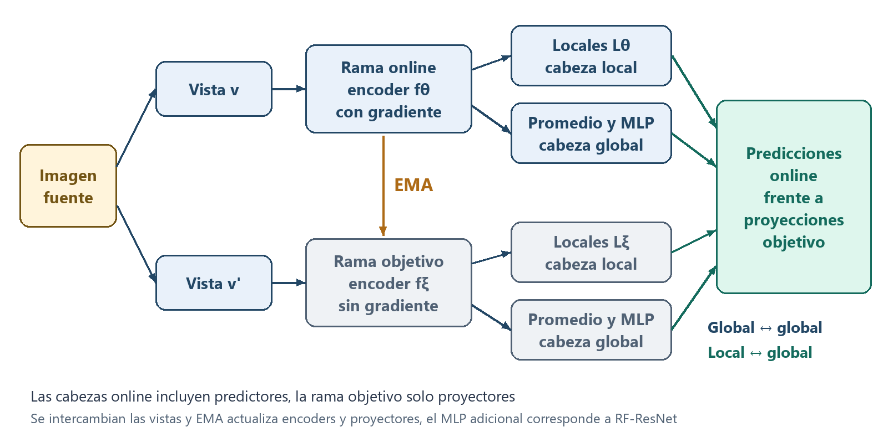

# Metodología y correspondencia con las fuentes

Esta versión distingue el mecanismo común y el calendario histórico de fase 1 de la continuación de fase 2, el estado vigente está en INFORME.md y las tablas de resultados, los valores históricos no se atribuyen a los entrenamientos posteriores.

## Problema y alcance

El laboratorio solicita recuperar imágenes de una persona observada por cámaras distintas y prohíbe utilizar etiquetas de identidad durante el entrenamiento, el artículo estudia aprendizaje autosupervisado para clasificación y propone alinear representaciones locales con globales de otra vista, la adaptación conserva ese aprendizaje y sustituye la sonda de clasificación por recuperación con el encoder congelado.

La referencia principal es la publicación final de Aubret, Teulière y Triesch de 2026, identificada por DOI 10.1016/j.neucom.2026.132973, las diferencias de una prepublicación anterior no se incorporan como si pertenecieran al PDF recibido, CO-DINO no se añade al alcance de esa publicación y DINO se conserva como comparador independiente de su tabla.

## Pérdidas y ramas

La rama online contiene encoder, proyectores y predictores, la rama objetivo contiene encoder y proyectores y no recibe gradientes, sus parámetros se actualizan mediante media móvil exponencial de los parámetros online, BatchNorm conserva estadísticas de sus propias pasadas y ambas ramas se comparan en validación y prueba.

BYOL utiliza menos dos por el coseno entre una predicción online y una proyección objetivo detenida, CO añade el promedio espacial de local online frente a global objetivo y global online frente a local objetivo, se incluyen las dos direcciones entre vistas y el peso local multiplica la suma de ambos términos, esa construcción corresponde a las ecuaciones 1 a 3 de la página 3 del artículo.

$$d(p,z)=-2\,\cos\left(p,\operatorname{sg}(z)\right)$$

$$L_g=d(p_g,z'_g)+d(p'_g,z_g)$$

$$L_l(v,v')=\frac{1}{K}\sum_{i=1}^{K}\left[d(p_{l,i},z'_g)+d(p_g,z'_{l,i})\right]$$

$$L_{CO}=L_g+w_s\left[L_l(v,v')+L_l(v',v)\right]$$

$$\xi\leftarrow m\xi+(1-m)\theta$$

El esquema representa una dirección entre vistas y se aplica también al intercambiarlas, los predictores pertenecen únicamente a la rama online y el MLP adicional posterior al promedio corresponde a RF-ResNet.

MoCoV3 utiliza InfoNCE con positivos correspondientes a la misma imagen fuente y negativos de las demás imágenes del batch físico, se conserva el factor dos por temperatura y el promedio de las posiciones locales, no existe cola de memoria ni acumulación que simule negativos ausentes, por ello batch ocho cambia materialmente la comparación frente a los entrenamientos grandes de referencia.

El aprendizaje une vistas de una imagen y no fotografías distintas de una misma identidad, MoCoV3 podría tratar como negativos dos registros de la misma persona porque training no permite identificarlos, esa posibilidad no se cuantifica sin etiquetas y no se introduce agrupamiento o una pérdida de identidad ajena al artículo para corregirla.

El proyector global de BYOL tiene dos capas ocultas de 4096 y salida de 256, su predictor tiene una capa oculta de 4096, MoCoV3 con CNN conserva un proyector de una capa oculta y BatchNorm final sin parámetros afines, su predictor tiene una capa oculta, las cabezas locales independientes tienen una capa oculta de 4096 y salida de 256 con convoluciones espaciales.

La variante de cabeza compartida aplica el mismo proyector y predictor global a cada posición local, por ello BYOL utiliza también dos capas ocultas en la proyección local compartida frente a una en la cabeza local independiente y BatchNorm recibe tanto ejemplos globales como posiciones locales, esa comparación representa la reutilización efectiva de la cabeza implementada y no aísla únicamente compartir parámetros con una profundidad local idéntica.

La página cuatro del artículo especifica dos capas ocultas para el proyector BYOL, el conteo de parámetros de cabezas de la tabla H.13 no coincide con ese proyector al sumar también el predictor, se conserva la especificación explícita del método principal y se informan los parámetros reales del proyecto sin ajustar la arquitectura para forzar la cifra de esa tabla.

Las pérdidas y la actualización EMA se escribieron en el proyecto, torchvision y timm aportan arquitecturas estándar y operaciones generales, no se importa una implementación completa de CO-SSL, solo-learn, BYOL, MoCoV3 o DINO para ejecutar el método.

## Arquitecturas

| Familia | Construcción | Diferencia relevante |
|---|---|---|
| ResNet50 | Arquitectura estándar de torchvision | Sin pesos externos y sin clasificador |
| ResNet18 | Arquitectura estándar con inicio 3 por 3 y sin max pooling | Panel de 64 por 64, no equivale al panel grande |
| RF-ResNet50 | Bloques propios con convoluciones espaciales seleccionadas y MLP residual tras pooling | Se mantienen kernels 3 por 3 en el primer bloque y el bloque intermedio de cada etapa |
| RF29-ResNet18 | Bloques propios y profundidad ampliada, campo 29 | Panel pequeño y paso de salida cuatro |
| BagNet33 | Control con bloques propios y RF33 | Implementación de la arquitectura local, no se afirma igualdad exacta de parámetros con un checkpoint externo |
| ViT-S/16 | Arquitectura estándar de timm | Pooling medio de tokens de parche, token CLS excluido de la lectura |
| Swin-T, Swin-S y Swin-B | Arquitecturas estándar de timm | Cabeza local espacial de kernel tres por defecto, drop path cero salvo Swin-B con 0.1 |

RF99 elimina el max pooling inicial y utiliza strides dos en las tres transiciones de etapa, las variantes RF39, RF67, RF115 y RF163 cambian únicamente esos factores y la presencia del pooling inicial, la figura A.6 denomina RF193 una configuración cuyo cálculo literal produce 195 y se conserva el identificador rf195_paper193 para hacer visible esa discrepancia.

La modificación RF incorpora un bloque adicional y un MLP residual posterior al promedio, quitar el MLP requiere reentrenamiento y es distinto de leer un checkpoint antes del MLP, ambas variantes se distinguen en la matriz y en el ejecutor de análisis.

Los campos teóricos se comprobaron recorriendo los módulos convolucionales y de pooling realmente construidos en CPU, RF99 produce campo 99 y un mapa derivado de catorce por catorce a resolución 224, RF29 produce campo 29 y mapa de dieciséis por dieciséis a resolución 64, los detalles completos se conservan en campos_receptivos_teoricos.json y no se confunden con una medición de campo efectivo mediante gradientes.

La ResNet50 estándar de torchvision produce campo teórico 427 frente al valor aproximadamente 425 mencionado en el texto del artículo, se informa la estructura real de la biblioteca sin alterar sus kernels para forzar esa aproximación, RF39 y RF115 pasaron la construcción CPU y posteriormente completaron entrenamiento, validación y prueba en la continuación autorizada, sus evidencias actuales se encuentran en COMPARACION_ARQUITECTURAS.md.

En ViT se agrupan ventanas de seis por seis tokens para la proyección local y en Swin tres por tres, la selección uniforme de posiciones locales de la tabla de cantidad se realiza mediante índices de una cuadrícula reproducible, esa elección no se presenta como un detalle que el artículo describa de forma completa.

La convolución local utiliza ventanas válidas sin padding, aumentar el kernel reduce también la cantidad de posiciones de salida y el promedio de pérdida se ajusta a esa cantidad, el padding no está explicitado en el artículo y se conserva esta decisión visible para no atribuirle una especificación ausente.

## Aumentos, optimización y recursos

Se leen los píxeles HDF5 sin modificar los archivos, las vistas aumentadas existen únicamente en memoria, se aplican recorte aleatorio, inversión horizontal, variación de color, escala de grises, desenfoque y solarización, el intervalo de aspecto del recorte pasa a 0.375 hasta dos tercios para adaptarse a la proporción vertical de las personas.

El mínimo de área de recorte principal es 0.2, las configuraciones de 0.9 conservan un recorte reducido y no equivalen a eliminar completamente la operación geométrica, los paneles multicrop utilizan dos vistas grandes y cuatro pequeñas, DINO utiliza seis pequeñas, las escalas globales 0.14 a uno y locales 0.05 a 0.14 se mantienen como adaptación común del comparador multicrop de CO-SSL y no como reproducción literal de todos los ajustes de DINO original.

En fase 1 las CNN BYOL y MoCoV3 utilizan LARS con momento 0.9 y regularización 0.0000015, la tasa de referencia 0.2 se escala por batch dividido entre 256, los Transformers y DINO utilizan AdamW con tasa de referencia 0.0005 escalada de la misma forma, no se realizó el barrido completo de tasas del artículo por el límite de tiempo y los valores elegidos se registran como decisiones locales.

La tasa sigue un calentamiento que ocupa como máximo el diez por ciento de las actualizaciones locales y un descenso coseno posterior, el momentum EMA parte de 0.996 y se acerca a uno, la precisión mixta utiliza bfloat16 y las pérdidas se calculan en float32, la selección de cantidad de pasos procede del coste medido y no se redondea como si se hubieran completado las épocas del artículo.

Las semillas y las configuraciones permiten repetir el procedimiento y el muestreo de imágenes, no se promete identidad bit a bit entre equipos o versiones de CUDA porque no se fuerza una implementación determinista de todas las operaciones GPU.

DINO emplea una cabeza propia de tres capas con dimensión oculta 2048, cuello de botella 256, normalización y salida 65536, utiliza centrado EMA con factor 0.9, temperatura estudiante 0.1 y temperatura objetivo desde 0.04 hacia 0.07 durante treinta épocas reales, la última capa se congela durante la primera época real, el clipping es tres y el decaimiento de pesos sigue de 0.04 a 0.4 durante el calendario local.

El historial registra la norma del gradiente anterior al clipping, por eso un valor registrado mayor que tres en DINO no significa que se haya aplicado una actualización sin el límite configurado.

Un entrenamiento menor de una época puede dejar la última capa de DINO congelada durante toda la ejecución, se conserva esa condición para no simular una época completa inexistente y su interpretación exige reconocer el escaso entrenamiento, no se comparan directamente los valores absolutos de pérdidas de BYOL, MoCoV3 y DINO como si fueran una métrica común.

El batch de entrenamiento no está fijado en los HDF5 ni en las instrucciones del laboratorio, el batch 64 del apéndice H del artículo pertenece a su medición de coste, el valor local de ocho se utiliza por igual y no se presenta como una exigencia de las fuentes, el batch de inferencia 64 no cambia los ejemplos ni los negativos de entrenamiento.

El calendario local común de fase 1 comprende 1253 actualizaciones con ocho imágenes fuente por actualización y 10024 originales distintos de training, la fracción de época registrada es 1253 dividido entre los 1380 batches completos disponibles y equivale aproximadamente a 0.908, los tres registros sobrantes de una época se descartan mediante drop_last para mantener BatchNorm y el batch físico constantes, no se crea otra partición y los resúmenes conservan por separado la longitud original de 11043 registros y el hash de los índices visitados.

## Continuación de fase 2

La fase 2 conserva el método central, los datos, las particiones, el batch ocho y la entrada 224, continúa diecinueve checkpoints de fase 1, catorce arquitecturas CO-BYOL y cinco controles, con dos épocas adicionales completas para todos, 2760 actualizaciones nuevas y 4013 acumuladas, unas 2.908 épocas equivalentes, las 32104 visitas acumuladas no son imágenes distintas y no son diecinueve inicializaciones nuevas.

Se probaron tres tasas CNN con RF99 y tres Transformer con ViT mediante pilotos de 400 pasos descartados, la validación eligió tasa base común CNN 1.6 y Transformer 0.0003, efectivas 0.05 y 0.000009375 antes del calendario, no se reproduce un ajuste exhaustivo por arquitectura ni se usa testing para elegirlas, el optimizador y el calendario EMA se reinician explícitamente y la mejora no puede atribuirse solo a más épocas.

La recomputación de la rama online reduce memoria manteniendo los buffers BatchNorm durante la repetición, se probó antes de la ejecución con verificaciones dirigidas CPU y calibraciones GPU, la elección de época y rama se hace por media de mAP de validación original y LR y ambas ramas de la misma época se prueban después de congelar la selección global, el candidato de época cero son pesos aprendidos de fase 1 y no inicialización aleatoria, los 44 análisis históricos no se repitieron sobre los nuevos pesos.

## Evaluación

Las condiciones original y reducida se refieren al contenido de los datasets HDF5 de consulta, se aplica a ambas la misma adaptación de tamaño requerida por el encoder y la misma normalización, aumentar el tamaño de una consulta reducida no recupera la información perdida y no constituye un método de superresolución.

El protocolo de Market-1501 excluye los elementos junk con etiqueta menos uno y las coincidencias de igual persona y cámara, mantiene los distractores de etiqueta cero y calcula positivos de otras cámaras, estas reglas proceden de la documentación oficial del conjunto y no de una suposición por similitud con otro dataset.

En el análisis de máscaras se conserva una cantidad entera de posiciones mediante muestreo sin reemplazo, las consultas originales y sus versiones reducidas reciben los mismos patrones espaciales al restaurar el estado aleatorio entre condiciones, las proporciones usan la misma semilla y la galería se extrae una sola vez para cada proporción.

AP se implementa como la media de precisiones en los rangos de positivos y mAP como su media por consulta válida, esta convención se declara y no se afirma identidad numérica con antiguas variantes de integración trapezoidal, Rank uno, cinco y diez miden si aparece al menos un positivo dentro del prefijo correspondiente.

Las representaciones se normalizan L2 y se ordenan por coseno, los empates conservan el orden original de galería, las consultas sin positivos se informarían de manera explícita y no se convierten en aciertos, en los datos inspeccionados todas disponen de positivos de otras cámaras.

La media de mAP de validación original y reducida selecciona configuración y rama antes de prueba, los resultados de prueba no deciden hiperparámetros, el análisis adversarial utiliza identidades solo para construir el objetivo evaluativo de ataque a consultas y no actualiza parámetros del encoder.

PGD opera sobre copias de consultas originales en escala de cero a uno antes de adaptar su resolución al encoder, utiliza un inicio uniforme aleatorio dentro de la cota y acceso a los positivos de galería para definir el objetivo de recuperación, la semilla se reinicia por configuración y se comprueba la distancia máxima de cada ataque.

El artículo no explicita el inicio aleatorio, se adopta el valor por defecto documentado de LinfProjectedGradientDescentAttack en Foolbox y se declara como elección de la adaptación, no se afirma conocer el valor utilizado por los autores, las iteraciones y pasos siguen la tabla cinco cuando su descripción textual difiere, fuente https://foolbox.readthedocs.io/en/stable/modules/attacks.html.

## Matriz y estado de los experimentos

resultados/revision_cumplimiento.json conserva la auditoría de fase 1 y COMPARACION_ARQUITECTURAS.md presenta el cierre de la continuación autorizada, en esa sesión se completaron dos controles RF99 con recorte mínimo 0.9 con y sin CO, el resultado local no demuestra una mejora del término CO en esa condición, Places365 solo está identificado como pendiente en metadatos y no dispone de un ejecutor de transferencia literal.

La lectura de cabeza compartida no selecciona automáticamente el mejor punto antes o después del MLP como en la tabla seis, el análisis de campos efectivos usa una posición central por imagen y no reproduce las dos posiciones de la figura dos ni el submuestreo espacial de paso dos de la figura C.7, la medición de eficiencia tampoco reproduce el coste completo de entrenamiento y cabezas de la tabla H.13.

Quince registros históricos de representaciones conservan validation en el campo externo de partición aunque el resultado interno y el lector corresponden a training sin identidades, se mantiene esa discrepancia visible sin modificar la evidencia original, el generador de metadatos queda corregido para una eventual ejecución futura expresamente autorizada.

| Grupo | Fuente del artículo | Soporte en el proyecto | Alcance de la evidencia |
|---|---|---|---|
| BYOL, MoCoV3 y extensiones CO | Ecuaciones 1 a 3, tablas 1 y 2 | Modelos y pérdidas propias | Checkpoint y JSON de cada ejecución |
| CNN estándar, RF y Transformers | Tablas 1 y E.9, apéndice D | Panel principal de 29 configuraciones | Se declara ejecución solo cuando existe resumen |
| Multicrop y DINO | Comparadores del artículo | Vistas múltiples y pérdida DINO propia | Calendario local limitado y ajustes explícitos |
| Base frente a componente CO | Tabla 6 y laboratorio | Peso local cero con misma arquitectura | Ablación principal RF99, no se confunde con cambiar arquitectura |
| Peso y cantidad de locales | Tablas 3 y 7 | Configuración de peso y muestreo espacial | Valores ejecutados identificados en cobertura_experimentos.csv |
| Tamaños de recorte y RF | Figuras 4 y D.8 | Matriz de configuraciones | No equivale a repetir todas las semillas o datasets originales |
| MLP y cabeza compartida | Tabla 6 | Sin MLP al entrenar y cabeza compartida | Lectura antes de MLP disponible por separado |
| Kernel local Swin | Tabla F.10 | Kernel de uno a cinco | Configuraciones, sin resultados atribuidos antes de ejecutar |
| Capas de lectura y alineamiento | Tabla G.12 y apéndice I | Lectura intermedia y proyector en capa seleccionada | Las dos intervenciones se mantienen separadas |
| Máscaras internas | Tabla 4 | Fracciones 0.5 a 0.9 antes del promedio | Cantidad entera más cercana de posiciones conservadas, muestreo uniforme sin reemplazo |
| PGD | Tabla 5 | Ataque propio acotado en norma infinita | Objetivo de recuperación distinto del clasificador original |
| Similitud local y campo efectivo | Figura 5, figuras 2 y C.7 | Muestreo reproducible y gradientes de entrada | Estimación local con dieciséis imágenes de training sin etiquetas |
| Resolución 384 | Apéndice C | Análisis del encoder congelado a resolución 384 | El texto no exige reentrenar a esa resolución, se declara esta interpretación |
| Transferencia Places365 | Tabla G.11 | Pendiente de datos y protocolo | No disponible en los archivos recibidos |
| AMDIM y SD-BYOL | Comparaciones de la tabla 1 | No se declaran implementaciones verificadas | Alcance y procedencia pendientes |

La matriz completa contiene configuraciones redundantes entre tablas y el ejecutor deduplica los parámetros equivalentes, los calendarios largos son condiciones publicadas y no pruebas de ejecución local, la publicación de una configuración en JSON solo demuestra que puede solicitarse y no que se haya entrenado, evaluado o validado numéricamente.

Los valores de las configuraciones ampliadas se declararon antes de evaluar prueba y el orden operativo se revisó para cubrir componentes dentro del presupuesto, tras completar los controles y el barrido de cantidad local se intercalan kernels y capas de alineamiento aprovechando el control K64 disponible, plan_ampliacion.json conserva los órdenes anteriores y la revisión final verifica mediante SHA256 que solo cambió el orden y no las configuraciones, ninguna prioridad utiliza puntuaciones de prueba y la selección principal permanece cerrada.

## Cuestiones de las fuentes

El atributo final_training propone incorporar datos de validación después de seleccionar, el laboratorio no exige esa fase y se conserva training como único origen de aprendizaje para mantener una comparación auditable, esa decisión no resuelve la diferencia entre las fuentes mediante una supuesta instrucción común.

Los identificadores de training están anonimizados y no incluyen person_ids, no se puede comprobar directamente que las personas no coincidan con validación o prueba, las comprobaciones de píxeles e identificadores excluyen duplicados exactos y no excluyen identidades visualmente relacionadas.

La indicación de bibliotecas para audio de la página dos se mantiene como posible errata por su contradicción con las entradas exclusivamente de imagen de la página uno, no se incorporan entradas de audio ni se atribuye una corrección oficial al docente.

## Decisiones de la segunda fase

La exposición inferior a una época de fase 1 motivó continuar un panel de catorce arquitecturas y cinco controles con presupuesto común, la tasa pequeña de LARS se contrastó mediante pilotos y validación de inicialización aleatoria, no se asumió que BatchNorm causara el rendimiento ni que medir un tensor equivaliera a medir todos los pesos.

Se mantuvo la entrada cuadrada 224 y se pospuso la degradación LR durante aprendizaje para conservar la geometría local y no mezclar otra intervención con las tasas y el calendario, el laboratorio permite esa degradación pero no la exige, la adaptación rectangular y las múltiples semillas quedan fuera de los experimentos entregados, las cien consultas de validación y una semilla limitan la selección y la interpretación estadística.

## Uso de herramientas y atribuciones

Se utilizó un asistente de IA en Codex como apoyo para programación, revisión de código, organización de experimentos y redacción, la expresión implementación propia se refiere al mecanismo programado en este repositorio sin importar una implementación existente de CO-SSL y no afirma una autoría exclusivamente humana, los entrenamientos y métricas proceden de ejecuciones locales con PyTorch, la defensa individual requiere comprensión del método y del código y no se acredita con la generación automática de documentos.

El video utiliza síntesis local Piper, voz es_ES-sharvard-medium, basada en Spanish Harvard sentences de la Universidad de Edimburgo con licencia CC BY 3.0, el motor Piper se distribuye bajo GPL 3.0, esta narración no registra una exposición humana del grupo.

| Recurso de narración | Fuente y atribución |
|---|---|
| Modelo de voz es_ES-sharvard-medium | [Piper voices, modelo de voz](https://huggingface.co/rhasspy/piper-voices/tree/main/es/es_ES/sharvard/medium) |
| Datos Spanish Harvard sentences | [Universidad de Edimburgo, CC BY 3.0](https://datashare.ed.ac.uk/handle/10283/574) |
| Motor Piper | [OHF-Voice, GPL 3.0](https://github.com/OHF-Voice/piper1-gpl) |

La publicación académica conserva los resultados originales, el commit de ejecución a6dc59ab03ac869b5ab100c250492d19c07c5a39 conserva el código congelado, los cambios posteriores afectan a auditoría, documentación y preparación de la entrega, incluidas las referencias a materiales auxiliares retirados, el manifiesto CONTENIDO_PAQUETE.json identifica las fuentes modificadas, los modelos, las pérdidas, la lectura de datos y el cálculo de métricas se mantienen sin cambios.

## Referencias

Aubret, Teulière y Triesch, Seeing the whole in the parts with self-supervised representation learning, Neurocomputing 675, 132973, 2026, https://doi.org/10.1016/j.neucom.2026.132973.

Zheng y colaboradores, Market-1501 y documentación de evaluación, https://zheng-lab-anu.github.io/Project/project_reid.html.

Grill y colaboradores, Bootstrap your own latent, 2020, https://arxiv.org/abs/2006.07733.

Chen, Xie y He, An Empirical Study of Training Self-Supervised Vision Transformers, 2021, https://arxiv.org/abs/2104.02057.

Caron y colaboradores, Emerging Properties in Self-Supervised Vision Transformers, 2021, https://arxiv.org/abs/2104.14294.
