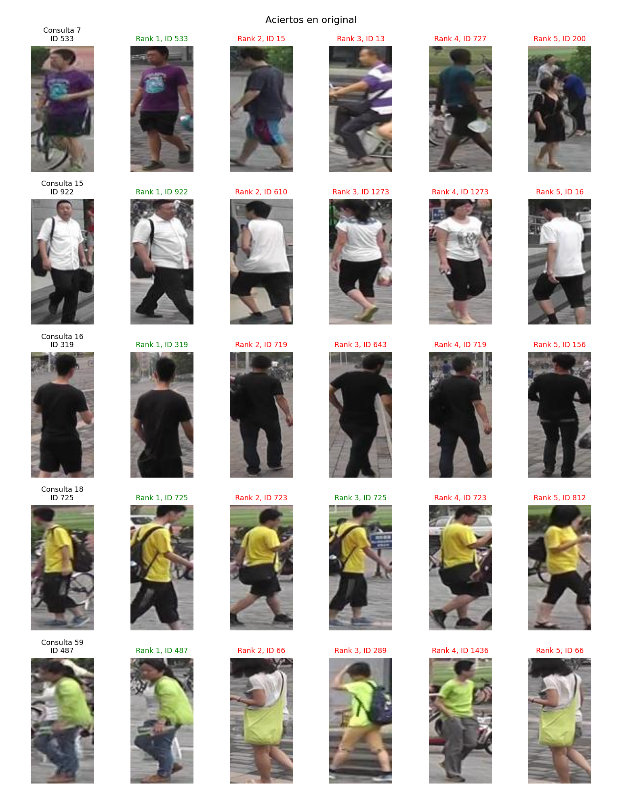
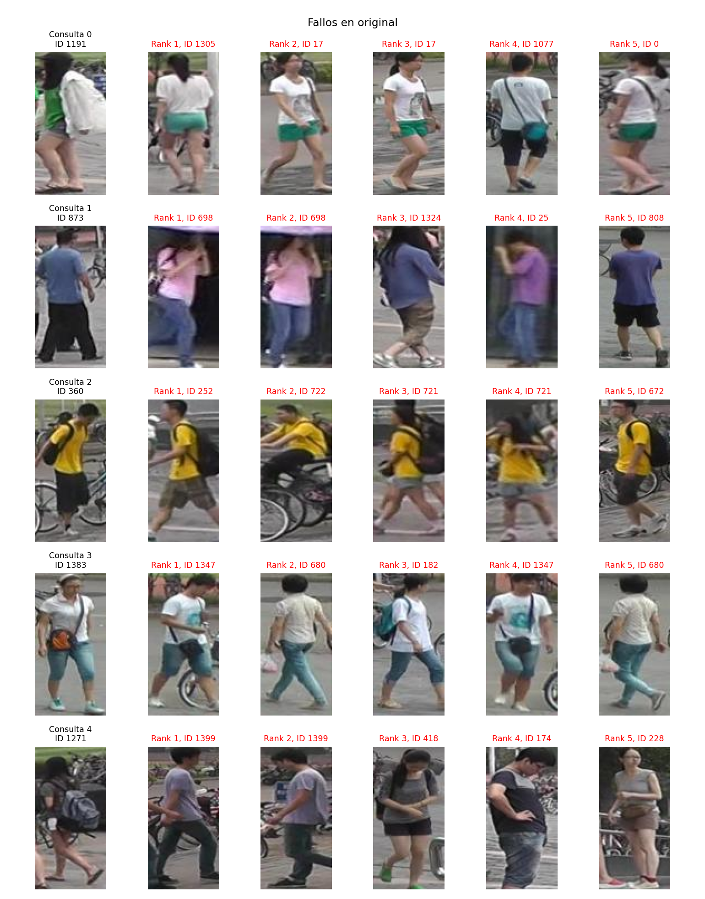
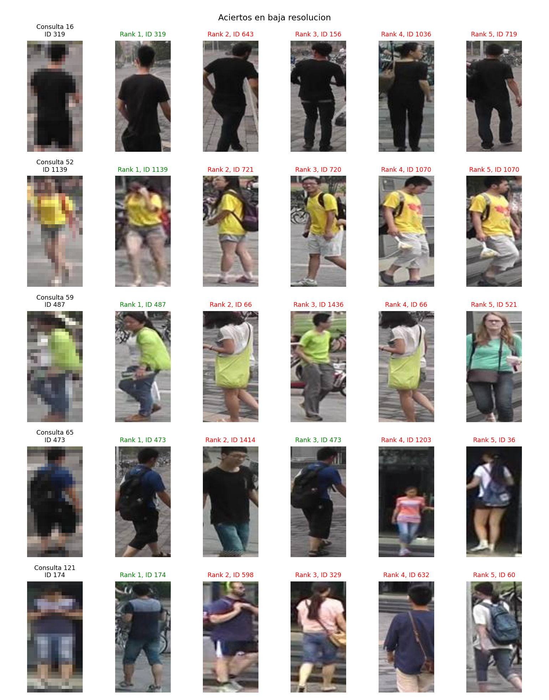
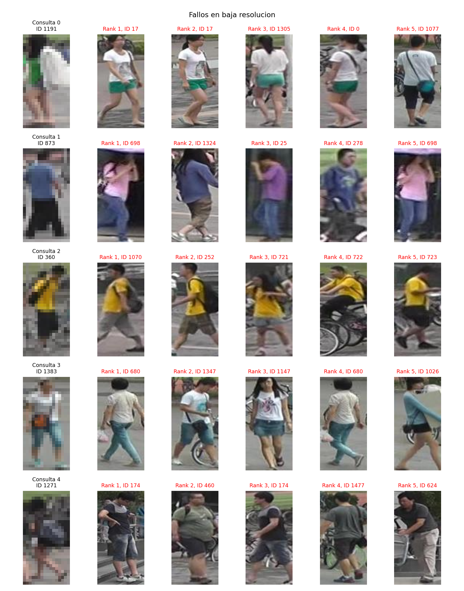

# Casos de recuperación de fase 2

Selección reproducible por índice y resultado Rank-1, estas explicaciones se basan en las etiquetas y rangos guardados, las figuras permiten revisar oclusión, encuadre e iluminación sin atribuir causas visuales no verificadas automáticamente.

Consulta 7 de identidad 533 y cámara 2, condición original, primer elemento recuperado identidad 533 y cámara 1, primer positivo en rango 1, el acierto recupera la misma identidad desde otra cámara bajo las exclusiones del protocolo.

Consulta 15 de identidad 922 y cámara 3, condición original, primer elemento recuperado identidad 922 y cámara 5, primer positivo en rango 1, el acierto recupera la misma identidad desde otra cámara bajo las exclusiones del protocolo.

Consulta 16 de identidad 319 y cámara 4, condición original, primer elemento recuperado identidad 319 y cámara 1, primer positivo en rango 1, el acierto recupera la misma identidad desde otra cámara bajo las exclusiones del protocolo.

Consulta 18 de identidad 725 y cámara 5, condición original, primer elemento recuperado identidad 725 y cámara 3, primer positivo en rango 1, el acierto recupera la misma identidad desde otra cámara bajo las exclusiones del protocolo.

Consulta 59 de identidad 487 y cámara 5, condición original, primer elemento recuperado identidad 487 y cámara 3, primer positivo en rango 1, el acierto recupera la misma identidad desde otra cámara bajo las exclusiones del protocolo.

Consulta 0 de identidad 1191 y cámara 3, condición original, primer elemento recuperado identidad 1305 y cámara 5, primer positivo en rango 121, el fallo sitúa otra identidad antes de cualquier positivo válido, la inspección visual detallada se presenta más adelante y no demuestra causalidad del encoder.

Consulta 1 de identidad 873 y cámara 5, condición original, primer elemento recuperado identidad 698 y cámara 6, primer positivo en rango 8, el fallo sitúa otra identidad antes de cualquier positivo válido, la inspección visual detallada se presenta más adelante y no demuestra causalidad del encoder.

Consulta 2 de identidad 360 y cámara 4, condición original, primer elemento recuperado identidad 252 y cámara 1, primer positivo en rango 1384, el fallo sitúa otra identidad antes de cualquier positivo válido, la inspección visual detallada se presenta más adelante y no demuestra causalidad del encoder.

Consulta 3 de identidad 1383 y cámara 2, condición original, primer elemento recuperado identidad 1347 y cámara 2, primer positivo en rango 777, el fallo sitúa otra identidad antes de cualquier positivo válido, la inspección visual detallada se presenta más adelante y no demuestra causalidad del encoder.

Consulta 4 de identidad 1271 y cámara 5, condición original, primer elemento recuperado identidad 1399 y cámara 1, primer positivo en rango 51, el fallo sitúa otra identidad antes de cualquier positivo válido, la inspección visual detallada se presenta más adelante y no demuestra causalidad del encoder.

Consulta 16 de identidad 319 y cámara 4, condición baja_resolucion, primer elemento recuperado identidad 319 y cámara 1, primer positivo en rango 1, el acierto recupera la misma identidad desde otra cámara bajo las exclusiones del protocolo.

Consulta 52 de identidad 1139 y cámara 3, condición baja_resolucion, primer elemento recuperado identidad 1139 y cámara 5, primer positivo en rango 1, el acierto recupera la misma identidad desde otra cámara bajo las exclusiones del protocolo.

Consulta 59 de identidad 487 y cámara 5, condición baja_resolucion, primer elemento recuperado identidad 487 y cámara 3, primer positivo en rango 1, el acierto recupera la misma identidad desde otra cámara bajo las exclusiones del protocolo.

Consulta 65 de identidad 473 y cámara 4, condición baja_resolucion, primer elemento recuperado identidad 473 y cámara 1, primer positivo en rango 1, el acierto recupera la misma identidad desde otra cámara bajo las exclusiones del protocolo.

Consulta 121 de identidad 174 y cámara 6, condición baja_resolucion, primer elemento recuperado identidad 174 y cámara 2, primer positivo en rango 1, el acierto recupera la misma identidad desde otra cámara bajo las exclusiones del protocolo.

Consulta 0 de identidad 1191 y cámara 3, condición baja_resolucion, primer elemento recuperado identidad 17 y cámara 4, primer positivo en rango 37, el fallo sitúa otra identidad antes de cualquier positivo válido, la inspección visual detallada se presenta más adelante y no demuestra causalidad del encoder.

Consulta 1 de identidad 873 y cámara 5, condición baja_resolucion, primer elemento recuperado identidad 698 y cámara 6, primer positivo en rango 11, el fallo sitúa otra identidad antes de cualquier positivo válido, la inspección visual detallada se presenta más adelante y no demuestra causalidad del encoder.

Consulta 2 de identidad 360 y cámara 4, condición baja_resolucion, primer elemento recuperado identidad 1070 y cámara 1, primer positivo en rango 1330, el fallo sitúa otra identidad antes de cualquier positivo válido, la inspección visual detallada se presenta más adelante y no demuestra causalidad del encoder.

Consulta 3 de identidad 1383 y cámara 2, condición baja_resolucion, primer elemento recuperado identidad 680 y cámara 2, primer positivo en rango 800, el fallo sitúa otra identidad antes de cualquier positivo válido, la inspección visual detallada se presenta más adelante y no demuestra causalidad del encoder.

Consulta 4 de identidad 1271 y cámara 5, condición baja_resolucion, primer elemento recuperado identidad 174 y cámara 3, primer positivo en rango 825, el fallo sitúa otra identidad antes de cualquier positivo válido, la inspección visual detallada se presenta más adelante y no demuestra causalidad del encoder.

## Inspección visual posterior del 20 de octubre

Se revisaron las cuatro figuras existentes, veinte casos en total, no se eligieron imágenes nuevas ni se recalcularon rankings, las observaciones describen rasgos visibles y separan las hipótesis de confusión de una causa probada, el muestreo condicionado a cinco aciertos y cinco fallos no estima la tasa global de acierto.

| Condición | Tipo | Consulta | Primer positivo, rango | Observación visual y límite |
|---|---|---:|---:|---|
| original | aciertos | 7 | 1 | La camiseta morada con gráfico claro y la prenda inferior oscura se conservan en el primer positivo pese a un cambio de postura, hay otros resultados de tonos próximos que no son la misma identidad. |
| original | aciertos | 15 | 1 | La camisa blanca, el bolso oscuro y el pantalón largo oscuro aparecen en consulta y primer positivo, la lista contiene además negativos vestidos de blanco, el acierto no elimina la dificultad de separar vestuario parecido. |
| original | aciertos | 16 | 1 | La vista posterior y la combinación de camiseta y prenda inferior negras se conservan en el positivo, otros candidatos también visten de negro, el ejemplo acredita el acierto concreto y no una separación general por color. |
| original | aciertos | 18 | 1 | La camiseta amarilla y la mochila oscura de consulta y primer positivo coinciden bajo otra postura, los negativos inmediatos muestran prendas muy similares y hacen visible la ambigüedad del vestuario. |
| original | aciertos | 59 | 1 | La prenda superior verde brillante, la bandolera oscura y el pantalón se conservan en el positivo de otra vista, algunos negativos comparten zonas verdes grandes pero otra distribución de prendas. |
| original | fallos | 0 | 121 | La consulta combina una chaqueta blanca y una prenda verde en el torso, los primeros recuperados muestran camisetas blancas y prendas verdes en otra parte del cuerpo, se observa confusión entre distribuciones parecidas de color y no solo entre identidades con ropa idéntica, una etiqueta cero aparece como distractor y se conserva correctamente en el protocolo. |
| original | fallos | 1 | 8 | La consulta muestra una prenda azul y pantalón oscuro desde una vista posterior, los primeros resultados incluyen otras prendas rosadas, azules y moradas y tomas bajo sombra, la lista no preserva la identidad pese a algunas semejanzas de color, la imagen no permite aislar si dominó el fondo, la pose o la representación. |
| original | fallos | 2 | 1384 | La consulta y varios negativos comparten camiseta amarilla y mochila oscura, con diferencias en pantalón y postura, la coincidencia de esos rasgos visibles no basta para distinguir identidad y el primer positivo aparece muy lejos en el ranking. |
| original | fallos | 3 | 777 | La consulta contiene camiseta blanca, pantalón corto de mezclilla y bolso cruzado, varios negativos repiten camiseta clara, azul en la parte inferior y accesorios oscuros, la semejanza de vestuario ofrece una hipótesis de confusión y no demuestra por sí sola el mecanismo del encoder. |
| original | fallos | 4 | 51 | La mochila grande ocupa buena parte del torso de una consulta lateral con prendas oscuras y piernas visibles, los negativos combinan ropa gris u oscura con vistas y encuadres distintos, la mochila y el cambio de vista son rasgos observables, su peso causal en el fallo no está medido. |
| baja_resolucion | aciertos | 16 | 1 | Aun con el detalle pixelado, se conservan la silueta posterior y las zonas negras del torso y prenda inferior, el primer recuperado es positivo y los negativos muestran también vestuario oscuro. |
| baja_resolucion | aciertos | 52 | 1 | La consulta conserva una zona amarilla amplia y una zona inferior corta y oscura, el positivo mantiene esa combinación y el accesorio lateral, otros candidatos amarillos no comparten la identidad. |
| baja_resolucion | aciertos | 59 | 1 | La gran región verde brillante sigue siendo visible después de la reducción, el positivo conserva además un accesorio oscuro y pantalón, el éxito es compatible con señales gruesas preservadas y no demuestra cuál decidió el modelo. |
| baja_resolucion | aciertos | 65 | 1 | Se distinguen grandes zonas azul y negra y el volumen oscuro de la mochila pese al pixelado, el positivo mantiene esa estructura desde otra postura, su identidad correcta se acredita con las etiquetas de evaluación. |
| baja_resolucion | aciertos | 121 | 1 | Persisten una zona clara en la parte superior de la camiseta, torso oscuro y prenda inferior azul, el positivo muestra una combinación compatible aunque cambien la postura y los detalles disponibles. |
| baja_resolucion | fallos | 0 | 37 | La consulta combina una chaqueta blanca y una prenda verde en el torso, los primeros recuperados muestran camisetas blancas y prendas verdes en otra parte del cuerpo, se observa confusión entre distribuciones parecidas de color y no solo entre identidades con ropa idéntica, una etiqueta cero aparece como distractor y se conserva correctamente en el protocolo. En LR desaparecen bordes finos y detalles de accesorios, se conserva el patrón grueso de color, esto cambia el orden de los candidatos pero no convierte esta consulta en un acierto Rank-1. |
| baja_resolucion | fallos | 1 | 11 | La consulta muestra una prenda azul y pantalón oscuro desde una vista posterior, los primeros resultados incluyen otras prendas rosadas, azules y moradas y tomas bajo sombra, la lista no preserva la identidad pese a algunas semejanzas de color, la imagen no permite aislar si dominó el fondo, la pose o la representación. En LR desaparecen bordes finos y detalles de accesorios, se conserva el patrón grueso de color, esto cambia el orden de los candidatos pero no convierte esta consulta en un acierto Rank-1. |
| baja_resolucion | fallos | 2 | 1330 | La consulta y varios negativos comparten camiseta amarilla y mochila oscura, con diferencias en pantalón y postura, la coincidencia de esos rasgos visibles no basta para distinguir identidad y el primer positivo aparece muy lejos en el ranking. En LR desaparecen bordes finos y detalles de accesorios, se conserva el patrón grueso de color, esto cambia el orden de los candidatos pero no convierte esta consulta en un acierto Rank-1. |
| baja_resolucion | fallos | 3 | 800 | La consulta contiene camiseta blanca, pantalón corto de mezclilla y bolso cruzado, varios negativos repiten camiseta clara, azul en la parte inferior y accesorios oscuros, la semejanza de vestuario ofrece una hipótesis de confusión y no demuestra por sí sola el mecanismo del encoder. En LR desaparecen bordes finos y detalles de accesorios, se conserva el patrón grueso de color, esto cambia el orden de los candidatos pero no convierte esta consulta en un acierto Rank-1. |
| baja_resolucion | fallos | 4 | 825 | La mochila grande ocupa buena parte del torso de una consulta lateral con prendas oscuras y piernas visibles, los negativos combinan ropa gris u oscura con vistas y encuadres distintos, la mochila y el cambio de vista son rasgos observables, su peso causal en el fallo no está medido. En LR desaparecen bordes finos y detalles de accesorios, se conserva el patrón grueso de color, esto cambia el orden de los candidatos pero no convierte esta consulta en un acierto Rank-1. |

Las consultas 7, 15 y 18 pasan de Rank-1 correcto en original a rangos 3, 34 y 4 en LR, mientras 52 y 121 mejoran de 2 a 1 y de 4 a 1, la consulta 4 pasa de 51 a 825, esas variaciones de consultas concretas conviven con una caída media de mAP relativamente pequeña y no deben ocultarse al hablar de robustez.
