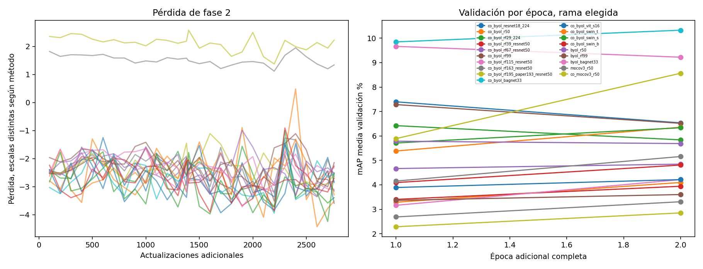

# Fase 2, resultados reales y alcance

Terminada el 20 de octubre a las 06:52 de Bogotá, diecinueve continuaciones, dos épocas adicionales comunes, batch ocho, época y rama elegidas con validación, la época adicional cero conserva el checkpoint aprendido de fase 1 y no indica una red sin entrenar.

El análisis entre fases y los límites se encuentran en [COMPARACION_FASES.md](COMPARACION_FASES.md) y en [../INFORME.md](../INFORME.md), el CSV completo conserva la configuración, ambas caídas, tiempos y memoria, la tabla siguiente identifica todos los controles por nombre para evitar confundir las variantes que comparten arquitectura.

| Configuración | Rama | Época extra elegida | mAP O % | R1 O % | R5 O % | R10 O % | mAP LR % | R1 LR % | R5 LR % | R10 LR % | Caída pp | Min train F2 |
|---|---|---:|---:|---:|---:|---:|---:|---:|---:|---:|---:|---:|
| co_byol_resnet18_224 | online | 0 | 1.861 | 4.394 | 9.531 | 13.302 | 1.432 | 2.672 | 7.037 | 10.570 | 0.429 | 9.276 |
| co_byol_r50 | objetivo | 2 | 0.605 | 1.395 | 4.216 | 6.354 | 0.502 | 0.891 | 2.939 | 4.810 | 0.103 | 7.555 |
| co_byol_rf29_224 | online | 1 | 1.331 | 3.771 | 8.848 | 12.233 | 0.810 | 1.366 | 4.394 | 6.770 | 0.521 | 30.644 |
| co_byol_rf39_resnet50 | online | 2 | 0.788 | 1.603 | 5.048 | 8.165 | 0.363 | 0.416 | 1.336 | 2.375 | 0.425 | 91.151 |
| co_byol_rf67_resnet50 | objetivo | 2 | 0.960 | 1.722 | 5.048 | 8.106 | 0.591 | 0.802 | 2.405 | 4.157 | 0.369 | 16.789 |
| co_byol_rf99 | online | 1 | 1.324 | 2.791 | 7.898 | 12.084 | 1.140 | 2.108 | 6.740 | 9.768 | 0.184 | 12.322 |
| co_byol_rf115_resnet50 | objetivo | 2 | 0.747 | 1.544 | 5.018 | 8.165 | 0.321 | 0.475 | 1.188 | 2.257 | 0.427 | 12.032 |
| co_byol_rf163_resnet50 | objetivo | 2 | 0.509 | 1.069 | 3.385 | 5.671 | 0.331 | 0.178 | 1.544 | 2.553 | 0.178 | 11.896 |
| co_byol_rf195_paper193_resnet50 | online | 2 | 0.580 | 0.861 | 3.414 | 5.641 | 0.311 | 0.534 | 1.425 | 2.286 | 0.270 | 12.075 |
| co_byol_bagnet33 | objetivo | 2 | 2.167 | 5.909 | 12.233 | 17.696 | 2.014 | 4.662 | 10.808 | 15.588 | 0.153 | 10.509 |
| co_byol_vit_s16 | online | 2 | 0.736 | 1.633 | 5.166 | 7.809 | 0.676 | 1.128 | 4.840 | 7.571 | 0.060 | 7.237 |
| co_byol_swin_t | online | 2 | 1.296 | 3.147 | 9.145 | 13.688 | 1.193 | 2.643 | 7.749 | 11.966 | 0.102 | 8.983 |
| co_byol_swin_s | objetivo | 2 | 1.142 | 2.702 | 8.373 | 12.678 | 1.086 | 2.702 | 7.363 | 11.194 | 0.056 | 13.822 |
| co_byol_swin_b | objetivo | 2 | 0.850 | 1.811 | 6.087 | 9.204 | 0.802 | 1.544 | 5.226 | 8.581 | 0.048 | 15.171 |
| byol_r50 | objetivo | 1 | 0.903 | 1.781 | 5.315 | 8.937 | 0.892 | 1.752 | 5.048 | 7.957 | 0.011 | 7.196 |
| byol_rf99 | objetivo | 2 | 0.552 | 0.920 | 3.711 | 6.057 | 0.353 | 0.297 | 1.574 | 2.494 | 0.200 | 11.862 |
| byol_bagnet33 | objetivo | 1 | 2.017 | 5.760 | 11.520 | 16.271 | 1.889 | 4.424 | 9.828 | 14.192 | 0.128 | 9.572 |
| mocov3_r50 | objetivo | 2 | 0.933 | 2.049 | 5.819 | 9.353 | 0.741 | 1.099 | 4.305 | 6.770 | 0.192 | 7.082 |
| co_mocov3_r50 | online | 2 | 1.909 | 4.840 | 11.758 | 16.835 | 1.675 | 4.186 | 10.006 | 14.222 | 0.234 | 7.469 |

Las dos ramas del mismo checkpoint están en comparacion_ramas_fase2.csv y en los JSON individuales, no se eligió rama por puntuación de prueba ni se modificaron resultados históricos, una sola semilla y pocas épocas impiden afirmar significación o convergencia.

[Casos y límites de interpretación](ANALISIS_ERRORES_FASE2.md)
